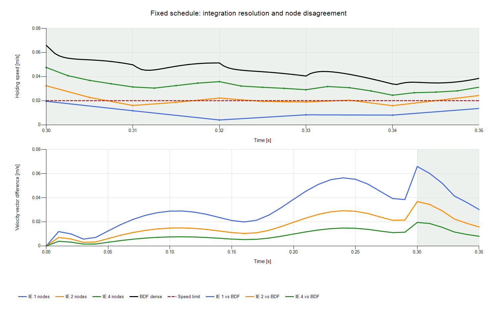
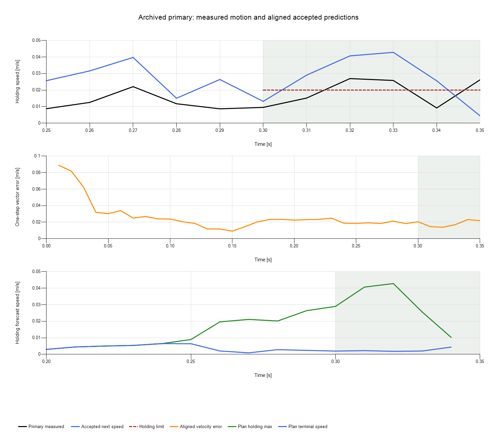
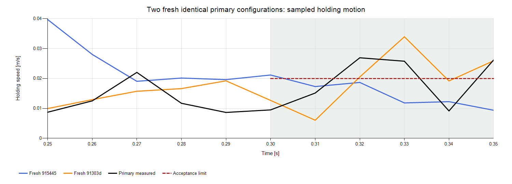

# 数值诊断交付 nd1011

本工程里程碑完成；机器人保持任务仍未通过。下一步应继续数值/模型诊断，随后再做有证据支持的控制适配；现在不恢复基于单次结果的 LLM 参数排序。

研究实际起点：Actual goal start: 2026-10-11 13:26:41 UTC / 21:26:41 Asia/Shanghai; includes engineering activity.。基线 `a03a746b3aea2dc305e07e4ff813eb58864df48b`，数值实施绑定 `b9ff0f31366f729b29acebab2a4654cf80bd565e`。历史 STOP 研究保持封存，归档输入保留原归属。应用层研究模型请求为 **0**。

## A：离线优化与独立积分

保存轨迹与检查点保留点完全一致；最大归一化动力学残差 2.781e-07。紧根求解的 1 子步重构与保存轨迹最大速度状态分量差 2.134e-06 rad/m/s。原始零状态、24 维状态顺序、物理缩放、世界坐标、六腱顺序及全部 35 条命令已检查。原离线序列化 NLP 未归档，不能声称恢复了所有求解运行条件。

| 独立积分配置 | 原任务采样保持误差 mm | 保持速度 m/s | 对紧 BDF 的最大节点速度向量差 m/s | 采样接受 |
|---|---:|---:|---:|---|
| IE substeps=1 | 5.199589 | 0.019524745 | 0.065930692 | True |
| IE substeps=2 | 5.167780 | 0.032409797 | 0.036870567 | False |
| IE substeps=4 | 5.469500 | 0.047531438 | 0.019518910 | False |
| tight BDF | 5.938780 | 0.065882630 | reference | False |

首次超过 0.002 m/s 的节点速度向量差已出现在 0.01 s；详见摘要中的逐节点状态、位置与速度向量差。BDF 收紧容差后最大节点速度向量变化仅 7.208e-10 m/s，远小于分辨率误差。证据支持离散积分误差，数值阻尼与结果相符，但未唯一分离模态耗散。保持差异不是保存轨迹不满足离散方程造成的。

修复：BDF 报告将原任务采样接受、优化器节点积分一致性、密集采样诊断及优化器输出线性插值比较分开。插值速度不再作为连续真值或接受门。保存数据重分类及一个有区别的静态夹具验证该修复；本候选仍失败。密集采样不构成连续时间保证。

未启动重新优化。诊断模式在启动前实际保护一项对应独立积分验证和 450 s，名额/时间不足会拒绝；本研究将 6 次积分用于三个 IE 分辨率、一次 BDF 精度比较及两个闭环短区间，已无独立验证名额。

## B：相同输入的动作差异

早期输入来自 unified-research-20261011 的 update 1，缺少完整解析问题；当前完整输入来自已封存 mechanics-control-20261011 主案例的 update 1，原问题图通过哈希归档引用恢复。两组分别与自己的原执行比较，不把跨研究动作差当作相同配置证据。初始化向量、边界、序列化表达式身份及已保存点的目标/约束检查相符；这些检查不重建历史缓存、尾求解器或计时历史。更正了导入早期归档时从文件夹名称推断的 study_id 标签；原输入和计算结果未改变，原标签与更正引用均保留。

| 源输入 / 条件 | 新迭代 | 停止原因 | 对自己原命令的最大差 N | 可行残差 |
|---|---:|---|---:|---:|
| unified-research-20261011 / fresh / production | 18 | budget_best_feasible | 0.302740884 | 2.192e-13 |
| mechanics-control-20261011 / fresh / production | 5 | relative_seed_improvement | 0.010485992 | 1.425e-12 |
| mechanics-control-20261011 / reused / production | 5 | relative_seed_improvement | 0.010485992 | 1.425e-12 |
| mechanics-control-20261011 / fresh / fixed_iteration | 8 | diagnostic_work_cap | 0.092412711 | 3.423e-11 |
| mechanics-control-20261011 / reused / fixed_iteration | 8 | diagnostic_work_cap | 0.092412711 | 3.423e-11 |

当前输入的固定工作量 fresh/reused 原始返回全变量最大差为 0.000e+00；对应前置解也一致。生产 fresh/reused 当前输入均在第 5 次迭代结束，原执行第 4 次；旧输入本次第 18 次，原第 8 次。差异首先出现在 raw 返回；retained/recovery/delivered 的全过程、数值可行性与选择均保存在证据中。没有发现需要修复的生产动作丢失。

修复：固定工作量诊断关闭可行返回计时、IPOPT CPU 和墙钟限制，保留回调工作量上限、收敛终止和外部进程超时。生产记录的 tracing 始终关闭，生产停止策略保持原样。reused 条件先进行一次计费的相同输入前置解，不冒称重建了实际前序 update。旧输入唯一原因仍未证实，也不承诺生产比特确定性。

新完整重复给出了更强的机制证据：update 10（0.10 s）的模型图、求解设置、变量/初值、测量状态、前一命令和暖启动完全相同，tracing 均关闭。一条运行在第 5 次迭代、5.7167165 s 停止，另一条在第 4 次、5.0850756 s 停止。第一条保留的第 4 迭代点与第二条 raw 返回全变量完全一致；第一条额外 raw 第 5 点不可行，随后 reintegration 将残差降至 1.4e-12 并选择更优张力，首命令因此改变 0.009705 N。结合原 5 s 最小计时停止条件，这定位了停止时点与恢复选择造成的动作机制，不能泛化为所有旧差异的唯一原因。

## C：闭环为什么不稳定保持

主案例全程最大一步速度向量误差 0.088812212 m/s 位于 0→0.01 s；保持窗口最大值 0.023160969 m/s 位于 0.33→0.34 s。主案例接受 31 个非初始化方案，初始化选择 4 次，不可用方案 0 个。

最大有效 horizon 为 10 个控制步，绝对保持开始 0.30 s，braking lead 为 0，保持节点从当前时刻 0.20 s 起进入 horizon。接近窗口时接受计划已含超限速度；末端预测常很低，不能代表整个保持窗口。请求与施加的腱命令完全相同，保持阶段输入未逼近全部 8 N 上界；这不能证明足够控制权限，也不支持简单归因于饱和。保留方案与恢复方案均有可行性依据，没有观察到把有用方案无故丢弃的证据。

| 同状态/输入短区间 | IE 对物理速度向量误差 m/s | BDF 对物理误差 m/s | IE 与 BDF 差 m/s |
|---|---:|---:|---:|
| update 0 | 0.088812212 | 0.020601453 | 0.108408119 |
| update 34 | 0.021868509 | 0.022833211 | 0.000984993 |

两段保存的一步预测在同一 mass/force 方程下残差分别接近机器精度与 3.3e-11。初始区间说明离线与 NMPC 确有共同积分误差机制；末端区间里 IE/BDF 只差约 0.000985 m/s，物理误差却约 0.022 m/s。积分精度不能解释保持失败；投影/模型差异及软保持规划的贡献仍未分离。保持世界位置投影误差约 3 mm，单凭该值也不能确定主因。没有进行权重扫描或无依据的提前制动修改。

## 两次新完整闭环与成本

| 新执行 | 保持位置误差 mm | 保持速度 m/s | 原任务接受 |
|---|---:|---:|---|
| `915445cd505747a68b58e2abfaac936c` | 4.489960 | 0.021178577 | False |
| `91303d29d332467fac27633d2db39390` | 4.134912 | 0.033970633 | False |

两次执行的完整科学配置及评估版本相同；均由 fresh 执行生成、记录完整输入。观察到的保持速度范围 [0.021178577443400647, 0.033970633480733786]，跨度 0.012792056 m/s。它只是两次观察，不是未来变动上界，更不能据此排序不同控制权重。

评价规则：每个待比较配置都需匹配的独立重复；保留失败与观察范围；范围重叠或求解变动尚未在性能尺度上测清时，拒绝参数优劣结论。一次有利结果不建立改进，固定迭代也不作为生产修复。

数值成本 1282.193/10800 s；独立 NMPC 7/8 次、151.050/1200 s（含两个前置解）；独立积分 6/6；离线重优化 0/1；MuJoCo 2/4；模型请求 0/0。闭环内部 70 次 NMPC 更新只计入各自仿真，没有重复收费。活动时间包含实施与交付，最大 8 h。

10 项独立的针对性检查通过；没有运行全仓套件、种子扫描或额外 smoke。70 条新控制输入与其原问题链接均验证；原研究缺失的一条输入仍不补造。归档/成员哈希已校验。

最小下一实验：新预算内，从主案例末端保存的完整 MuJoCo 状态与对应投影状态出发，固定同一命令，对比初始世界运动、短区间加速度和投影残差，区分降阶/状态投影误差与反馈规划误差；之后才选择控制适配。原离线候选若需要进一步优化，应使用更细转录并预留独立 BDF 验证，不能用旧离散任务通过作为验证。

[诊断规范](../examples/numerical_diagnosis/specification.json) · [运行说明](numerical_diagnosis_runbook.md) · [机器摘要](../evidence/numerical_diagnosis_20261011/scientific_summary.json) · [归档清单](../evidence/numerical_diagnosis_20261011/archive_manifest.json) · [原封存报告](mechanics_control_completion.md)
