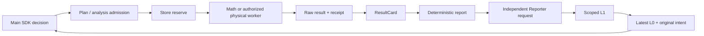

# F3 preflight integration

This is engineering preparation, not authorization to launch F3. Historical F3.0
main → Reporter → main delivery and source citation passed; strict main-Agent
semantic admission remains `failed_semantic_admission`. Formal F3 has not started.

## Baseline and execution ownership

Fetched origin before implementation. `integration/s129-research` is
`d17852c33a2f1c85d50f44ee5772b831fbdb418e`; the mathematical branch is
`138ee27912914672c02d3a8e0a1c6e587d208580`, contains that mainline, and is four
commits ahead. Created isolated `.worktrees/f3-prestudy`, branch
`integration/f3-prestudy`, directly from the latter. No task-intake merge.

`agent.converse` owns SDK tools and decision requests. `core.dispatch` owns Plan
admission; `analysis.dispatch` owns mathematics admission and Store reservation.
`execution_worker` builds the candidate model and calls the selected kernel.
`analysis.recover` persists raw outputs, costs and receipts. `evidence_views`
projects ResultCards, `reporter.assemble` creates deterministic ScientificReports,
and Reporter interpretation is separate, non-authoritative L1. `research_context`
rebuilds L0 from saved evidence, intentions and receipts. Physical execution and
the frozen independent evaluator remain the only task-acceptance source. Existing
Store and Session managers retain their respective ledgers and native histories.

## Stage A

Added opt-in `family_sensitivity_variables` with version `family_sensitivity_v1`
and explicit `variables`. Domain catalog and defaults come from the existing
FamilySpace generator. Per-candidate topology limits, sparse defaults, actual
regenerated robot/mesh, source, profile, task, controller, discretization and
model binding are checked before using saved models. Length-derived geometry is
validated by the frozen generator. Original fixed-candidate T2 remains intact.

Candidate evidence supports `view=mathematical_capabilities`: it discovers only
already registered symmetric model groups and invokes the actual T2 admission
gate. L0 carries a compact status and this exact query. No model is generated or
solved by discovery. Cost planning separates kernel 5/9, required models 3/5,
validated reuse, missing/unknown prerequisites, and preparation costs. From-zero
examples are 8/14 via one-evaluation linearization or 11/19 via two-evaluation
SOCP. These are conditional plans, not altered Store charges.

Validation: 49 tests passed across `test_f3_family_sensitivity`,
`test_s130_mainline`, `test_conic_capability`, `test_capability_sensitivity`.
Family generation and Store tests are real; the new T2 binding tests use explicitly
synthetic saved matrices and a substituted applicability assessment. T1/T2 kernel
unit tests use numerical fixtures. No real scientific worker request or Provider
request was made by these tests. Full F3 scientific capability is not established.

Stages B/C, final evidence, final SHA and readiness verdict are pending.
