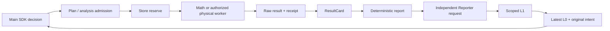

# F3 preflight integration

This is engineering preparation, not authorization to launch F3. Historical F3.0
main → Reporter → main delivery and source citation passed; strict main-Agent
semantic admission remains `failed_semantic_admission`. Formal F3 has not started.

## Baseline and execution ownership

Fetched origin before implementation. `integration/s129-research` is
`d17852c33a2f1c85d50f44ee5772b831fbdb418e`; the mathematical branch is
`138ee27912914672c02d3a8e0a1c6e587d208580`, contains that mainline, and is four
commits ahead. Created isolated `.worktrees/f3-prestudy`, branch
`integration/f3-prestudy`, directly from the latter. No task-intake merge.

`agent.converse` owns SDK tools and decision requests. `core.dispatch` owns Plan
admission; `analysis.dispatch` owns mathematics admission and Store reservation.
`execution_worker` builds the candidate model and calls the selected kernel.
`analysis.recover` persists raw outputs, costs and receipts. `evidence_views`
projects ResultCards, `reporter.assemble` creates deterministic ScientificReports,
and Reporter interpretation is separate, non-authoritative L1. `research_context`
rebuilds L0 from saved evidence, intentions and receipts. Physical execution and
the frozen independent evaluator remain the only task-acceptance source. Existing
Store and Session managers retain their respective ledgers and native histories.

## Stage A

Added opt-in `family_sensitivity_variables` with version `family_sensitivity_v1`
and explicit `variables`. Domain catalog and defaults come from the existing
FamilySpace generator. Per-candidate topology limits, sparse defaults, actual
regenerated robot/mesh, source, profile, task, controller, discretization and
model binding are checked before using saved models. Length-derived geometry is
validated by the frozen generator. Original fixed-candidate T2 remains intact.

Candidate evidence supports `view=mathematical_capabilities`: it discovers only
already registered symmetric model groups and invokes the actual T2 admission
gate. L0 carries a compact status and this exact query. No model is generated or
solved by discovery. Cost planning separates kernel 5/9, required models 3/5,
validated reuse, missing/unknown prerequisites, and preparation costs. From-zero
examples are 8/14 via one-evaluation linearization or 11/19 via two-evaluation
SOCP. These are conditional plans, not altered Store charges.

Validation: 49 tests passed across `test_f3_family_sensitivity`,
`test_s130_mainline`, `test_conic_capability`, `test_capability_sensitivity`.
Family generation and Store tests are real; the new T2 binding tests use explicitly
synthetic saved matrices and a substituted applicability assessment. T1/T2 kernel
unit tests use numerical fixtures. No real scientific worker request or Provider
request was made by these tests. Full F3 scientific capability is not established.

Stage A committed and ordinarily pushed as `f43249db` (see final commit inventory).

## Stage B

The installed public `OpenAIModel.format_request` builds a request-only tail after
SDK-formatted history. `BeforeModelCallEvent` refreshes L0 after settled Reporter
delivery and derives legal tools. The stable system prefix remains first; native
history and tool IDs are unchanged. Saved unconsumed responses use their original
tail, and LiveBoundary still rejects any whole-wire hash mismatch. Reporter has
its independent report/source-catalog request, never the main history. See
`evidence/f3_prestudy/request_tail_measurements.json` for actual SDK request byte
counts, message roles and tail positions under MockTransport.

Session handoff still performs prepare → snapshot → independent restore → verify
→ atomic commit. New native history contains one identity anchor, not old chat;
the next request gets fresh L0. Intentions, unresolved questions, results, budgets,
original receipts and all L2/L3 artifacts stay in Store. Two rotations, paired
tool recovery, unknown sends, snapshot tampering, dynamic schemas and explicit
live-handoff admission are covered. No production live admission flag was set.

`initialize_control` accepts `control_seed.method=capability_sequence` with only
candidate and `response_evidence`. It validates registered frozen SOCP provenance,
exact candidate/task/model/channel/units, full original time grid, finite bounded
inputs, and repeats the existing independent affine replay. It uses the existing
physical execution binding and `explicit_control_schedule_v1`. Original numerical
and physical execution identities are separate. Task-failing but valid bounded
sequences remain diagnostic. Acceptance is always `unmeasured`, inheritance false.
This starts no physics and may feed independently authorized physical replay or
control search. GVS execution uses its existing scene execution identity; SoRoSim
retains its existing specification identity.

Offline regression: 177 tests, 175 passed, 2 additional real-worker tests skipped.
The initial expanded run was interrupted and is not represented as a passing suite.
Its legacy GVS/SLSQP test did execute two real worker requests (three reserved
evaluations) in temporary offline fixtures; these were not SOCP or physical runs.
All subsequent broad-suite real scientific worker launches are blocked. Earlier
environment/import/old-fixture failures and corrections are itemized in
`validation_attempts.json`. Historical Store recovery reads the original archive
and verifies its byte hash unchanged. Numerical fixture substitutions are listed
in `offline_regression.json`, rather than presented as scientific observations.

The new isolated `.f3-prestudy-env` uses the exact mainline lock plus CVXPY 1.9.3
and Clarabel 0.11.1. MATLAB R2024a's existing built Python package is referenced
only by this environment's `.pth`. The shared Python/RL environments are untouched.
Sandbox MATLAB startup failed with an access-denied message; that original failure
is retained. The authorized unrestricted environment probe passed startup,
SoRoSim gateway, sqrt(4), and shutdown, without scientific model construction.

Stage C real SOCP and final readiness verdict remain pending.
