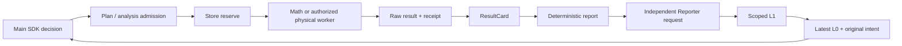

# F3 preflight integration

This is engineering preparation, not authorization to launch F3. Historical F3.0
main → Reporter → main delivery and source citation passed; strict main-Agent
semantic admission remains `failed_semantic_admission`. Formal F3 has not started.

## Baseline and execution ownership

Fetched origin before implementation. `integration/s129-research` is
`d17852c33a2f1c85d50f44ee5772b831fbdb418e`; the mathematical branch is
`138ee27912914672c02d3a8e0a1c6e587d208580`, contains that mainline, and is four
commits ahead. Created isolated `.worktrees/f3-prestudy`, branch
`integration/f3-prestudy`, directly from the latter. No task-intake merge.

`agent.converse` owns SDK tools and decision requests. `core.dispatch` owns Plan
admission; `analysis.dispatch` owns mathematics admission and Store reservation.
`execution_worker` builds the candidate model and calls the selected kernel.
`analysis.recover` persists raw outputs, costs and receipts. `evidence_views`
projects ResultCards, `reporter.assemble` creates deterministic ScientificReports,
and Reporter interpretation is separate, non-authoritative L1. `research_context`
rebuilds L0 from saved evidence, intentions and receipts. Physical execution and
the frozen independent evaluator remain the only task-acceptance source. Existing
Store and Session managers retain their respective ledgers and native histories.

## Stage A

Added opt-in `family_sensitivity_variables` with version `family_sensitivity_v1`
and explicit `variables`. Domain catalog and defaults come from the existing
FamilySpace generator. Per-candidate topology limits, sparse defaults, actual
regenerated robot/mesh, source, profile, task, controller, discretization and
model binding are checked before using saved models. Length-derived geometry is
validated by the frozen generator. Original fixed-candidate T2 remains intact.

Candidate evidence supports `view=mathematical_capabilities`: it discovers only
already registered symmetric model groups and invokes the actual T2 admission
gate. L0 carries a compact status and this exact query. No model is generated or
solved by discovery. Cost planning separates kernel 5/9, required models 3/5,
validated reuse, missing/unknown prerequisites, and preparation costs. From-zero
examples are 8/14 via one-evaluation linearization or 11/19 via two-evaluation
SOCP. These are conditional plans, not altered Store charges.

Validation: 49 tests passed across `test_f3_family_sensitivity`,
`test_s130_mainline`, `test_conic_capability`, `test_capability_sensitivity`.
Family generation and Store tests are real; the new T2 binding tests use explicitly
synthetic saved matrices and a substituted applicability assessment. T1/T2 kernel
unit tests use numerical fixtures. No real scientific worker request or Provider
request was made by these tests. Full F3 scientific capability is not established.

Stage A committed and ordinarily pushed as `f43249db` (see final commit inventory).

## Stage B

The installed public `OpenAIModel.format_request` builds a request-only tail after
SDK-formatted history. `BeforeModelCallEvent` refreshes L0 after settled Reporter
delivery and derives legal tools. The stable system prefix remains first; native
history and tool IDs are unchanged. Saved unconsumed responses use their original
tail, and LiveBoundary still rejects any whole-wire hash mismatch. Reporter has
its independent report/source-catalog request, never the main history. See
`evidence/f3_prestudy/request_tail_measurements.json` for actual SDK request byte
counts, message roles and tail positions under MockTransport.

Session handoff still performs prepare → snapshot → independent restore → verify
→ atomic commit. New native history contains one identity anchor, not old chat;
the next request gets fresh L0. Intentions, unresolved questions, results, budgets,
original receipts and all L2/L3 artifacts stay in Store. Two rotations, paired
tool recovery, unknown sends, snapshot tampering, dynamic schemas and explicit
live-handoff admission are covered. No production live admission flag was set.

`initialize_control` accepts `control_seed.method=capability_sequence` with only
candidate and `response_evidence`. It validates registered frozen SOCP provenance,
exact candidate/task/model/channel/units, full original time grid, finite bounded
inputs, and repeats the existing independent affine replay. It uses the existing
physical execution binding and `explicit_control_schedule_v1`. Original numerical
and physical execution identities are separate. Task-failing but valid bounded
sequences remain diagnostic. Acceptance is always `unmeasured`, inheritance false.
This starts no physics and may feed independently authorized physical replay or
control search. GVS execution uses its existing scene execution identity; SoRoSim
retains its existing specification identity.

Offline regression: 177 tests, 175 passed, 2 additional real-worker tests skipped.
The initial expanded run was interrupted and is not represented as a passing suite.
Its legacy GVS/SLSQP test did execute two real worker requests (three reserved
evaluations) in temporary offline fixtures; these were not SOCP or physical runs.
All subsequent broad-suite real scientific worker launches are blocked. Earlier
environment/import/old-fixture failures and corrections are itemized in
`validation_attempts.json`. Historical Store recovery reads the original archive
and verifies its byte hash unchanged. Numerical fixture substitutions are listed
in `offline_regression.json`, rather than presented as scientific observations.

The new isolated `.f3-prestudy-env` uses the exact mainline lock plus CVXPY 1.9.3
and Clarabel 0.11.1. MATLAB R2024a's existing built Python package is referenced
only by this environment's `.pth`. The shared Python/RL environments are untouched.
Sandbox MATLAB startup failed with an access-denied message; that original failure
is retained. The authorized unrestricted environment probe passed startup,
SoRoSim gateway, sqrt(4), and shutdown, without scientific model construction.

Stage B committed and ordinarily pushed as
`c51d74d28bae0186951fea5542c5cc726cf7eef1`.

## Actual request boundaries and preserved intent

Main receives the stable research rules, native current-session messages and one
latest request-only L0. Its native tool result contains exact saved references.
Before its next request, Reporter receives a separate deterministic report and
source catalog; its scoped interpretation is saved as L1. Main then receives
updated L0 with that delivery, original intent, actual action, evidence references,
method restrictions and remaining budgets. Reporter cannot alter numerical facts,
acceptance, allowances or Main's decision. This ordering is exercised by the real
SDK under MockTransport; no real language-model reasoning was assessed here.

The redacted formatter fixture measured 595 and 604 bytes for two requests,
both with roles `system,user,assistant,tool,user`, L0 at index 4, identical fixed
prefix and native history, and preserved `native-id`. These are fixture sizes,
not measurements of full production prompts, cache hit rate or latency. The
saved second request was recovered byte-for-byte without a second HTTP send.
Existing native delivery tests additionally exercise main → Reporter → main.

After Session rotation the new native history contains the identity anchor;
stable rules and current L0 are supplied by the normal request builder. Full old
chat stays in its old SDK session. Candidates, sources, results, receipts,
research Plans, hypotheses and unresolved questions remain in Store and are
projected or retrieved by reference. Action traces name the selected conic/T2
method, candidate and protocol, connect preceding research intent, and explicitly
leave the hypothesis effect unassessed until interpreted. This does not infer
scientific support from a successful tool call. Two handoffs, feedback recovery,
unknown send rejection and snapshot/schema checks use existing Session machinery.

## FamilySpace and budget acceptance matrix

| Case | Outcome and evidence scope |
|---|---|
| One and nine segments; indexed length; two-step Young's modulus | Real generated candidates, full 3/5 saved-model groups admitted in contract fixtures |
| Sparse versus explicit defaults | Same generated candidate; actual regenerated geometry checked |
| Unauthorized variable, invalid index, changed generated geometry | Rejected before worker |
| Additional modulus, tendon count, segment count, routing, section or controller-weight change | Real generated candidates rejected by the single-parameter stencil gate |
| Foreign implementation/task/protocol/operating point; missing registered model; absent baseline | Rejected before worker |
| Cross-Study candidate | Current-owned-candidate check rejects; no foreign artifact becomes reusable |
| Different time/coordinate/constraint maps | Protocol and existing T2 kernel comparison tests reject |
| Original fixed-candidate T2 | Existing S130 and kernel regression passed |

Family contract tests use synthetic saved matrices and an explicitly substituted
task-applicability assessment; they do not demonstrate real regenerated robot
sensitivity or convergence. The original generator's bounds/clearance tests and
numerical T2 kernels run separately. No new optimizer or formula was introduced.

| Difference levels | Required saved models | Kernel reserve | From zero via linearization | From zero via SOCP |
|---|---:|---:|---:|---:|
| h | 3 | 5 | 8 | 11 |
| h and h/2 | 5 | 9 | 14 | 19 |

Only a validated full group is reported as reusable. Before this validation,
reuse/missing-model totals are `unknown`; from-zero examples are conditional
planning alternatives. A valid complete group costs only the 5/9 kernel reserve.
No prerequisite is created automatically. Candidate generation, Provider calls
and physical launches remain separately accounted. `Store.reserve`, retained
failure charges and completed-operation reuse are unchanged. Missing dependencies,
authorization, models, parameter applicability and budget have separate reasons;
authorization plus installed CVXPY alone never makes candidate T2 executable.

## Stage C: real mathematical result

New engineering Study: `f3-preflight-socp-20261022-01`. Frozen implementation:
`c51d74d28bae0186951fea5542c5cc726cf7eef1`. The runner refuses another request if
that Study already exists. It used a newly generated two-segment/three-tendon
FamilySpace candidate and the existing GVS builder. Its task was the engineering
`tasks/reach_hold.json`, **not** the proposed formal mirror task. Therefore this
run does not establish mirror-task feasibility or SoRoSim mathematical readiness.

| Observation | Actual value |
|---|---|
| Worker result | `computed`, real CVXPY/CLARABEL, `optimal`, 17 iterations |
| Model/kernel/dual-face attempts | 1 / 1 / 0 |
| Reserved and charged mathematics | 2 / 2 |
| Charged numerical wall time | 8.941454399842769 s |
| Objective / independently replayed violation | -0.19999999999441767 / -0.19999999999986867 |
| Replayed support gap | 7.608363938871321e-11 |
| Maximum prediction/replay discrepancy | 2.3869795029440866e-15 |
| Optimality label | `numerically_checked` |
| Repeated completed operation | 0 additional mathematical evaluations |
| Provider / physical / NMPC / PPO | 0 / 0 / 0 / 0 |
| Physical task acceptance | `unmeasured` |

Python entry and actual worker were both
`D:/softrobot-agent/.f3-prestudy-env/Scripts/python.exe`, Python 3.11.16, with
OPENBLAS/OMP/MKL threads all 1. Packages: Strands 1.59.0, harness 0.2.0,
Pydantic 2.14.0, NumPy 2.4.6, SciPy 1.17.1, CasADi 3.7.2, CVXPY 1.9.3,
Clarabel 0.11.1. Lock identities and solver availability are saved in
`evidence/f3_prestudy/environment.json`; actual worker facts are in the result.
The future entry must use this interpreter, not a shared environment lacking the
optional solver. RL retains its original independent interpreter.

Exact content-addressed references:

- Candidate: `395884912d4348ac9eb0bfabf100cca0b2479edbbaaa973f02ef69ed4d00ae04`
- Raw SOCP result: `7e347a23709e32829dee87bb7c15baddd056767f21419292b978b240560f0145`
- Unexecuted control source: `f12cb264bd4c7e714a8f2137452c59181e1c7f2a3c2068e16b99714a2e0664b9`

`real_socp_result.json` preserves the raw output; `real_socp_audit.json` contains
the original receipt, attempt boundaries and real charges.
`deterministic_delivery.json` preserves the ScientificReport/L1/L0 projection and
exact quantity pointers. `artifacts.json` exports every JSON artifact in this
new Store; read-only tests recompute all content hashes. The generic receipt's
`solver_status=not_run` is the existing service-envelope field, not the conic
kernel verdict: the scientific result explicitly records CVXPY/CLARABEL optimal
and its attempt record. No generic ledger counter was relabeled to imply a
Provider or physical call.

`control_handoff.json` records the real result's successful conversion to the
existing explicit schedule. Independent affine replay was recomputed without
solving again. Mathematical and physical execution identities are distinct;
the source is `unmeasured`, `inherited_acceptance=false`, and unused by physics.
It can be supplied to separately admitted `physical_replay` or `control_search`.
Offline cases also reject NaN, bounds violations, wrong channel/task/provenance
and incomplete horizon, and preserve task-failing inputs as diagnostic only.

This is floating-point, sampled affine-model evidence. It is neither a rigorous
global nonlinear optimum nor a continuous-time/hardware/physical certificate.
Clarabel's public stats do not expose all primal/dual residual fields; unavailable
fields and reasons are retained, not filled with inferred zeros.

## Validation accounting and limitations

| Run | Passed | Failed/error | Skipped/not completed | Scope |
|---|---:|---|---|---|
| Stage A targeted | 49 | 0 | 0 | Generator/Store contracts and T1/T2 numerical fixtures |
| Initial SDK attempt | Not a passing suite | 1 failure, 40 error records | Environment-dependent | Missing Engine import; original failure retained |
| SDK after environment fix | 34 | 1 error | 0 | Missing historical archive in isolated checkout |
| Original archive read-only rerun | 1 | 0 | 0 | Existing archive copied into recovery fixture, original hash unchanged |
| Expanded run 01 | Not totaled | Known fixture/import failures | Interrupted | Includes two legacy GVS/SLSQP requests, explicitly disclosed above |
| Corrected broad suite | 175 | 0 | 2 | 177 tests, real SDK/Store, MockTransport and numerical fixtures |
| Final production-change checks | 15 | 0 | 0 | S130, control handoff and request tail |
| Extended family/draft/evidence checks | 14 | 0 | 0 | Additional negatives, all exported hashes, pending guard |
| Final combined focused suite | 26 | 0 | 0 | Extended checks plus S130 and request tail; no scientific worker |
| Real engineering SOCP | 1 request | 0 | No second attempt | Real worker/model/Clarabel, mathematical reserve 2 |

Counts overlap and must not be summed as unique tests. Detailed named outcomes:
`offline_regression.json`, `final_focused_regression.json`, and
`validation_attempts.json`. The two omitted broad-suite cases intentionally launch
additional real mathematical workers. No full physics, NMPC run, PPO training or
real Provider request was performed. MuJoCo XML/model compilation in generator
tests is not a physics rollout. MATLAB engine-only probing is not SoRoSim science.
The first final-check shell returned status 1 because PowerShell wrapped unittest
stderr; its unittest report is 14/14 OK. The combined JSON runner confirms the
final outcomes independently and preserves that log.

Against mathematical baseline `138ee27912914672c02d3a8e0a1c6e587d208580`, production
code is **+306 / -20 (net +286)** across ten existing files. Tests and engineering
acceptance utilities are **+640 / -9 (net +631)**. Configuration, documentation
and raw evidence are excluded from these code counts. Kernels, Store, Budget
Manager, Session Manager and FamilySpace generator have no production edits.

## Formal F3 proposal and final commit binding

Versioned seed: `configs/research/study_f3_pending.json`; runtime:
`configs/research/runtime_f3.json`; approval inventory:
`evidence/f3_prestudy/f3_launch_proposal.json`. This is a valid resolved proposal
with `PENDING_EXPLICIT_APPROVAL`, not an existing or authorized Study. Its guard
rejects Provider/science before authorization. Historical budgets/results are
unchanged and `failed_semantic_admission` remains the historical verdict.

The proposed Study uses the original `tasks/reach_hold_mirror_v1.json` and original
acceptance, task identity
`d24aeac7041052ce1d2ae60e825a802e7367107784f6fec192b0a65c4a5e76e7`, FamilySpace
identity `0793d20569402760ca055f73f6f97d80d73d0fe3c051ff2b60ebad1519db02aa`.
The family declares 1–9 segments and 1–12 tendons, with 1–7 tendons executable;
candidate-specific dynamics/controller checks still apply. Length and modulus
grants list indices 0–8 explicitly, and each candidate's actual topology limits
valid variables. Existing section/material/routing domains are preserved.

Proposed limits are 48 Provider requests (4 protected, Reporter included),
200 public operations (12 protected), 24 mathematical evaluations including
prerequisite models, 16 physical launches, 2 NMPC executions, 1 PPO stage with
65,536 aggregate actions and 1 independent RL evaluation. Existing offline NLP=1
and BDF=2 limits are retained. These are proposals, not granted allowances.
SOCP/T2, existing math, explicit control seeding, replay/search, NMPC and RL remain
optional choices within separate scientific gates; no method order is mandated.

Session handoff is planned with explicit `--session-handoff` but
`session_handoff_live_admitted` remains false. The new Study needs its own
handoff authorization and live continuation admission; passing mocked requests
does not create this grant. Reporter remains independent and completes its saved
delivery before Main's next request. Its interpretations remain non-authoritative.

Commit inventory:

| Stage | Commit and ordinary push |
|---|---|
| A | `f43249db3d5742701ec07133f89f18fc017f3108`, pushed |
| B; actual real-worker implementation | `c51d74d28bae0186951fea5542c5cc726cf7eef1`, pushed |
| C; final evidence/config/tests/report | Full final SHA is appended in `runs/f3_prestudy_integration_final.md` by the post-commit binder |

A commit cannot contain its own SHA. After the final ordinary push, run
`D:/softrobot-agent/.f3-prestudy-env/Scripts/python.exe -m tests.research.f3_draft_binding`.
It binds the valid ignored `configs/research/.f3_pending_final.json` to the final
clean HEAD, resolves it through the normal loader, and writes
`runs/f3-final-binding.json` plus the complete final report
`runs/f3_prestudy_integration_final.md`. These final artifacts are the authoritative
future-Study proposal; the tracked seed's earlier implementation field is not the
final launch binding. This avoids a self-referential commit hash or pretending
that the earlier real-worker run executed later documentation commits. The final
production code remains the same as the actually exercised Stage B code.

Remaining approval/checklist for a future turn:

1. Approve final code SHA and resolved Study/task/family identities; materialize
   an independent authorization bound to them through the existing mechanism.
2. Approve Provider endpoint/payload and the separate main/Reporter request budget.
3. Approve mathematical, physical, NMPC and PPO counts/scopes; retain all failure
   charges and shared physical accounting.
4. Grant handoff and assess live continuation before changing its admission flag.
5. Confirm the new interpreter, pinned SoRoSim root and MATLAB process permission
   at actual launch; SoRoSim model construction in this new runtime and full
   mirror-task execution remain untested by this preflight.
6. Explicitly accept the preserved F3.0 semantic-reasoning risk while keeping
   deterministic scientific gates. Do not reinterpret prior failure as a pass.

## Engineering readiness

The requested minimal interfaces and deterministic safety/accounting gates are
implemented and verified; the bounded real GVS SOCP-to-evidence/control-source
path passed. The proposed full SoRoSim F3 is **conditionally prepared, not live
admitted**: it still requires independent approval, interpreter/process readiness
at launch and separate handoff admission. There is no remaining observed failure
in the corrected offline suites, but those tests cannot substitute for the
unexecuted SoRoSim/physical/live-provider scopes. Formal F3 has not started.

## Scientific capability validation

One real local GVS affine model was built, optimized with Clarabel, independently
replayed, saved with charges/receipt, projected into deterministic report/L0, and
converted into a valid unexecuted control source. T1/T2 numerical fixture and
FamilySpace authorization contracts passed. Real FamilySpace sensitivity across
physical models, mirror-task success, NMPC/PPO performance, autonomous hypothesis
formation/revision and research decision quality remain unvalidated. Only a
separately authorized F3 Study can assess those abilities.
