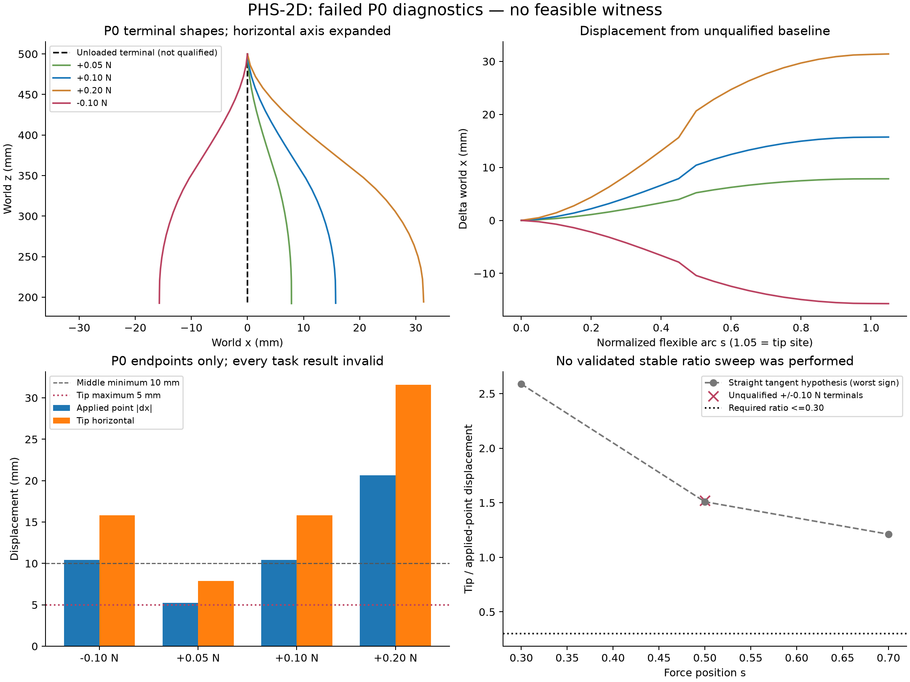
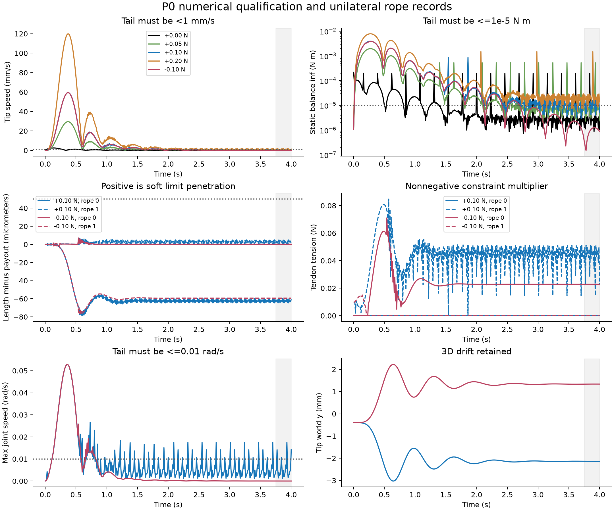

# PHS-2D 被动鸡头稳定研究：P0 失败停机交付

本轮**没有建立合格的被动静力平衡基准，也没有找到可行性见证**。
已实现并验证垂直安装、单侧固定放绳长度、真实材料点施力、独立测量、
局部约束柔顺性诊断及原 Store 证据链；P0 用满事前冻结的 100,000 步后仍
未通过无扰动平衡判据，因此停止积分，未进入 P1。不能将本轮称为完成了
全部验证的 Benchmark，更不能推断物理机制不可行。

## 冻结协议和物理结构

工具审计先于实现，见 [适用性矩阵](phs2d_audit.md)。原基线是
`314f75a4971e0a9e4521fe79ddf744ff71de61e2`，新分支为
`research/phs2d-passive-head-stabilization`。所有新实验均在自己的 Store。
未修改六项历史见证、导出包、历史 Store、Agent/Provider、Reach/Hold、
Tracking、工具轴评分或 BF2 COM 外力语义。

活动协议 [v2](../../configs/research/phs2d_protocol_v2.json) 保留了
[v1](../../configs/research/phs2d_protocol_v1.json) 的全部任务阈值：

| 项目 | 冻结值 |
|---|---|
| 世界 / 安装 | z 向上，重力 [0,0,-9.81]，Base [0,0,0.50] m；绕世界 y 正向转 90°，本体 +x 指向世界 −z |
| 本体 | 两段各 0.14 m，各 12 cells，共 48 个真实 3D 弯曲自由度 |
| 主力 / 搜索 | ±0.10 N；s=0.30、0.50、0.70 |
| 独立预留 | s=0.40、0.60，各 ±0.10 N |
| 成功测量 | tip 水平范数 ≤5 mm；受力点绝对 Δx ≥10 mm；比值 ≤0.30；监测点最大绝对 Δy ≤2 mm |
| 单次过程 | 重力基准 4 s；每个加载从同一基准 q、零速度开始，0.50 s smoothstep 加载、保持到 4 s |
| 尾窗 | 最后 0.25 s；tip 和所有监测点速度 ≤1 mm/s；漂移 ≤0.5 mm；全部关节速度无穷范数 ≤0.01 rad/s |
| 物理有效性 | 零速度重算静态广义力残差 ≤1e−5 N·m；腱超长 ≤50 μm；反力方向正确、容量不过限；全步无接触、无数值警告 |
| 求解 | MuJoCo 3.13.0，implicitfast；100 iterations、tolerance=1e−10；solreflimit=[0.004,1]，solimplimit=[0.999,0.999,0.001,0.5,2] |
| 步长版本 | v1=1 ms；v2=0.25 ms，记录间隔均 10 ms。v1 失败后、任何搜索前仅细化步长；未改力、阈值、装配参数或预算 |

`s` 是累计柔性材料长度的归一化坐标，**不包含刚性连接件长度**；在段边界
沿用编译器右侧 cell 约定。实际 tip_site 单独测量，不等同于 s=1 的柔段末点。
原型中的刚性件使 Base 到 tip 初始总落差为 0.308 m，tip 世界 z=0.192 m。
s=0.50 初始世界 z=0.346 m。该差异在几何审计和所有测量中明确保留。

唯一参考结构为合法 Base-only 两根对置全长腱：半径 20 mm，极角 π/2、3π/2，
两段各在 s=0.5 经过导向点，中间通过原导向刚体，终止于第二段 s=1。
两段 Young 模量均 2 MPa；截面、截面旋转、密度、黏性、刚性件和 10 g
payload 均继承公共原型。payload 的局部 COM=[0.007,0.001,−0.002] m 并非轴心；
世界重力因而在直杆处产生小横向广义力。不能预设完全二维或正负力镜像对称。
两根放绳长度均为 0.29399999999999993 m，取零形变实际路径长度，实验全程不变。
设计数据中的主动 pretension 字段在被动执行中不施加；没有额外预紧或控制输入。

完整真实结构、截面、材料、连接关系、每个腱路点及离散网格见
[reference_structure.json](../../evidence/phs2d_20261028/reference_structure.json)。
生成域保留原 FamilySpace 及其避让检查；PHS 入口只接受 1、2、4、6 根腱和
固定 0.28 m 柔性总长。本轮仅构建上述一个独特候选，未探索其它拓扑。

## P0 验证与失败

新增 `passive_fixed_payout_v1` 在每根空间腱设置 `[0,Lset]` 长度范围，
不生成 actuator、servo、腱弹簧或控制器。已有两个主动模式保持原义。
上限约束的 MuJoCo 行雅可比实际等于 `−Jell`，非负约束乘子产生拉力，
下限从未激活；反向加载时另一根腱张紧，未出现压缩腱证明。
这里仍是软约束数值模型，不是精确不可伸长绳证明。

材料点通过真实 cell 与局部轴向坐标定位，每步跟随刚体运动，
`mj_applyFT(F, torque=0, current_point)` 每步清空后只施加预定世界 x 向力。
无力时广义外力和刚体外力严格为零。材料点位置/雅可比与独立几何实现的
最大误差 3.89e−16；腱长误差 1.11e−16 m，腱雅可比误差 1.42e−16 m/rad。
定向测试另验证方向有限差分和虚功关系。

v1 做基准和 +0.05、+0.10、+0.20、−0.10 N 四次中点诊断，20,000 步。
v2 在同一非优化结构重复该预检，80,000 步。它是明确版本的步长复查，
不是未知请求重发，也不是相同参数的重复计算。所有 10 次调用都执行完 4 s，
无接触、无数值警告、无超出 50 μm 的腱长误差，反力方向检查通过。
但是静力资格并未通过：

| v2 工况 | 尾窗最大 tip 速度 mm/s | 最大关节速度 rad/s | 最大静态残差 N·m | 尾窗漂移 μm | 轨迹自身停稳 |
|---|---:|---:|---:|---:|---|
| 无外力 | 0.2782 | 0.003896 | 1.9711e−4 | 1.504 | 否：力残差 |
| +0.05 N | 0.7593 | 0.010494 | 5.3423e−4 | 3.345 | 否 |
| +0.10 N | 1.2328 | 0.017524 | 1.7128e−5 | 5.125 | 否 |
| +0.20 N | 2.1255 | 0.028356 | 1.4916e−3 | 12.033 | 否 |
| −0.10 N | 0.0351 | 0.0000113 | 1.2548e−6 | 3.491 | 是，但基准不合格 |

**所有加载结果均不能作有效任务评价**：它们起自未合格的基准末帧，只是 P0
诊断。很小的位移漂移没有掩盖速度/残差失败。细化步长没有给出单调的残差
收敛证据；目前不能把失败具体归因于绳松弛、物理失稳或某一种求解器缺陷。
尾窗的小幅快速变化与约束切换是待排查线索，尚未确证滞回、多稳态或屈曲。

| 中点诊断力 | 受力点绝对 Δx mm | tip 水平 mm | 比值 | 最大绝对 Δy mm |
|---|---:|---:|---:|---:|
| +0.05 N | 5.214 | 7.895 | 1.514 | 0.872 |
| +0.10 N | 10.413 | 15.822 | 1.519 | 1.741 |
| +0.20 N | 20.647 | 31.594 | 1.530 | 3.445 |
| −0.10 N | 10.400 | 15.804 | 1.520 | 1.737 |

这些是**不合格基准到末帧**的真实位移，不是稳定平衡指标。0.10 N 有足够的
中段响应量级，无需改力；然而该参考结构 tip 明显跟随，不能稳定鸡头。
v2 最终 +0.10 N 张力约 [0,0.02246] N，−0.10 N 约 [0.02284,0] N。
原始采样保留每根实际长度、相对放绳长度差、张紧标记、乘子、行残差、方向
误差、求解迭代数、速度、全 q 和中轴点位置。单点末帧不能替代尾窗检查。





## 数学关系与机制限制

设 U 为实际 hinge 弹性能加世界重力势能，g(q)=ell(q)−Lset。
理想被动绳满足 g≤0、λ≥0、λᵀg=0，平衡为

`grad U + Jellᵀλ − JFᵀF = 0`。

固定正张力集合 A 时，Kt 是 `U + λᵀell − FᵀpF` 的 Hessian，
增量解满足 `[Kt JAᵀ; JA 0] [dq; dλ] = [JFᵀdF; 0]`。
令 Z 为 JA 的零空间，则 `dq=Z(ZᵀKtZ)⁻¹ZᵀJFᵀdF`。
交叉柔顺性是 `Jtip Z(ZᵀKtZ)⁻¹ZᵀJFᵀ`，其 x/y 输出决定局部比值。
必须检查秩、最小特征值、残差和反力符号；λ=0 的边界使用单侧切锥 QP，
不能直接当成永远张紧的双侧约束。

新增小型 `passive_constrained_compliance_v1` 用原生 MuJoCo 静态力与腱雅可比，
中心差分形成 U 与 λᵀell 的切线 Hessian；只支持本轮**无外力工作点**。
因而 FᵀpF 项此处为零，不能把该实现泛称为任意加载平衡点求解器。
正乘子行保持等式，零乘子临界行用单侧线性不等式；SVD 零空间另给双侧对照。
没有开发新的 GVS/Cosserat 引擎，也没有使用主动 CONIC/T1/T2。

P0 后的两个数学请求分别在直杆、未合格无扰动末帧计算。两者均明确标为
`diagnostic_at_unverified_equilibrium`，不是有效平衡柔顺性证书：

| 工作点 | Jell 数值秩 / 零空间维数 | 受约束最小刚度特征值 | 静态站立残差 |
|---|---|---:|---:|
| 直杆 | 1 / 47 | 0.106533 N·m/rad | 2.17943e−4 N·m |
| 无扰动末帧 | 2 / 46 | 0.106481 N·m/rad | 1.12176e−6 N·m |

末帧的残差可以很小，但整个尾窗不合格，所以没有选择性地取末帧宣称成功。
直杆处奇异值为 [0.138564,3.54e−17] m/rad：对置两腱长度导数互为相反数，
只增加一个独立约束。它近似限制总弯角；tip 位置雅可比则以每个关节到 tip
的剩余臂长加权。**总弯角返回零，仍允许中段已经积累的末端平移**。
这由实际雅可比和切线响应支持，不是仅看最终形状的猜测。

| 受力位置 s | 直杆单侧切线预测受力点 mm | 预测 tip mm | 最差正负比值 |
|---|---:|---:|---:|
| 0.30 | 2.238 | 5.791 | 2.588 |
| 0.50 | 10.414 | 15.715 | 1.509 |
| 0.70 | 21.662 | 26.251 | 1.212 |

未合格基准的局部结果接近上述值；s=0.50 的真实有限力末帧比值约 1.52。
这是量级一致的诊断，不能宣称完成“切线预测对真实非线性平衡”的验证。
局部双侧与单侧预测在直杆几乎相同，也不证明有限变形下双侧反力可物理实现。
新的有效结构需要在保留 `JF dq` 的方向上显著抑制 `Jtip dq`；可研究不同
终止段、不同路线权重和分段刚度。但本轮未试验这些假设，不能归因收益。

## 未执行项与停止原因

| 项目 | 状态 |
|---|---|
| 六个正式搜索工况 | 全部 `not_run_P0_gate`；P0 的 s=0.50 数据不回填为正式搜索成功 |
| 四个预留工况 | 全部 `not_run_P0_gate`，未消耗/窥探 holdout 物理数据 |
| A 无腱限制、B 高刚度、C 路线/终止段对照 | 均未执行：P0 未通过且其冻结额度用尽 |
| D 双侧物理对照 | 未执行；仅有局部数学双侧比较 |
| 最优有效候选 / 成功见证 | 不存在；只交付唯一失败参考结构 |
| 搜索效率、单侧松弛导致不可行、结构域不足 | 均未建立结论，未执行搜索 |

止步原因是**数值平衡资格不足和已冻结的 P0 限额**，不是总预算不足、
有限结构优化失败或物理机制被否定。未使用剩余 4,900,000 步扩大 P0，
未通过放宽阈值、隐藏 out-of-plane、缩短本体、固定 tip 或外部支撑造成功。

## 证据、成本和复现

原 `core.prepare/bind/generate` 冻结 FamilySpace 并生成候选；其继承的 Reach
配置只用于合法构建，不执行、不评分。另在同一 Store 冻结 PHS 协议。
`Store.reserve` 的事务 guard 先保留物理步上界、数学次数及独占后端；
每次 `mj_step` 前计尝试，完成后原子结算。未完成请求保持保留并阻止重发。
输出、请求、独立开发性评价均为内容地址工件，没有新数据库或优化框架。

| 成本 | 本轮 |
|---|---:|
| 物理调用 / 尝试 / 确认步数 | 10 / 100,000 / 100,000 |
| P0 / 总硬上限 | 100,000 / 5,000,000 |
| Store 数学请求 | 4（两次几何审计、两次切线请求，各切线内部 6 个方向 QP） |
| 额外预备诊断 | 1 次 ad hoc 零状态力学读取未事前经 Store admission，保守另外计入；零积分 |
| 保守数学总数 / 上限 | 5 / 250；内部 QP 共12次，不是额外结构候选 |
| 独特完整候选 / 上限 | 1 / 60；另有一次相同结构的零积分预编译；单元测试是夹具 |
| Store 科学数值耗时 | 12.781 s；不包含编排、构建、测试、绘图与服务等待 |
| Provider / Research Agent / NMPC / PPO | 全部 0 |
| 未完成或未知请求 | 0 |

上述 ad hoc 诊断包含对初始 qacc、bias、原型参数的读取，未被伪装为已提前
通过 Store 预算准入；这是本轮证据流程的一项明确限制。所有真实积分均在
Store 请求和计数之内。Provider 费用为零，Codex 服务费用没有可核对明细。

[summary.json](../../evidence/phs2d_20261028/summary.json) 包含逐工况精确指标、
十条件状态、结构和成本；[raw_evidence.json.gz](../../evidence/phs2d_20261028/raw_evidence.json.gz)
保留全部采样、失败、原协议、请求、收据及候选工件。导出程序逐个核对43个
工件内容哈希、14个请求收据与累计步数，SHA-256 清单写在 summary 内。
原新 Store 位于工作树 `runs/phs2d/store`，不会使用原私有 Store。

在本工作树重做只读审计与绘图：

```powershell
& D:/softrobot-agent/.f3-prestudy-env/Scripts/python.exe -m tools.phs2d_export
& C:/Users/gugugaga/miniconda3/envs/softagent/python.exe -m tools.phs2d_plots
```

本 Study 最终以原 `core.dispatch(stop)` 封存；科学入口拒绝再次执行，
只读导出不受影响。封存前相同请求使用完整缓存，不重新积分。
若要在新机器重现实验，使用干净 checkout、相同依赖和全新授权 Store，先绑定
源码，再执行 p0。默认活动 v2 的五个实验为80,000步；历史 v1轨迹和源码提交
完整保留用于分版本复现。`diagnose` 只做已绑定的零积分数学诊断。
不得拷贝 Store 来重置授权；历史结果的只读 bundle 不构成新的执行许可。

验证：`tests.research.test_phs2d`、`test_native_external_force`、
`test_stage0_base_routing` 共30项通过；均为零积分契约测试。
最初测试因 Windows sandbox 的临时目录权限失败，改为工作树内普通夹具目录
后通过，未增加任何科学积分。Python 编译检查和 `git diff --check` 通过。

## 最小后续接口与理论工作

1. 先针对同一参考结构做约束求解器/时间步/柔性阻尼一致性诊断，检查尾窗
   高频残差来源；不能同时优化结构并调整数值阈值。需新的明确 P0 额度。
2. 对已知状态用互补静力条件求 q、λ，并核对 reduced Hessian 正定性；随后
   必须用独立 3D 被动积分确认吸引性。现有局部函数不代替该步骤。
3. 增加 typed passive assembly、moving material force 和 TaskAdapter；让
   evaluator 消费同一结构/放绳向量绑定的完整基准及十个独立轨迹。登记
   `evaluate.phs2d` 和 `passive_constrained_compliance`，仍不能调用 Reach SELECT。
4. 之后才让现有有界候选生成/坐标提案消费 PHS 最差工况违反量，做 A/B/C
   对照及预留验证。固定张紧集灵敏度应微分完整 KKT，并在张紧集切换处返回
   非光滑/不适用，而不是重优化控制获得 T2。

本轮交付的是**可复现的 P0 失败和受控开发能力**。尚未完成有效静力 Benchmark、
路线因果对照、完整十工况或成功结构机制的证明；这些缺口没有被成功标签覆盖。
