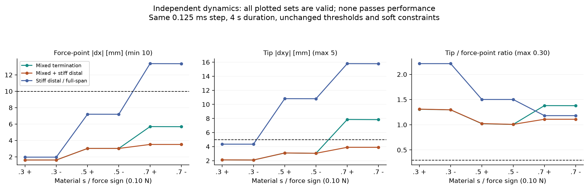
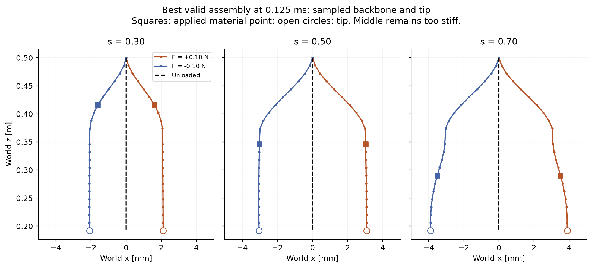
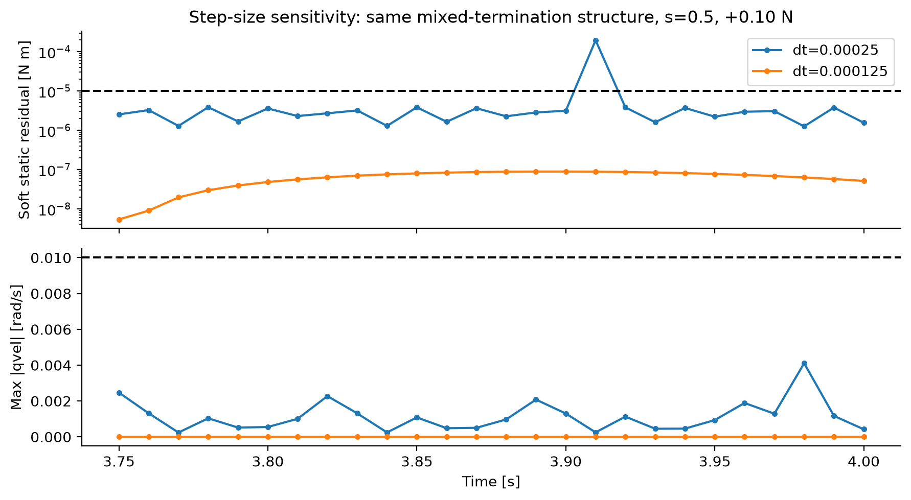
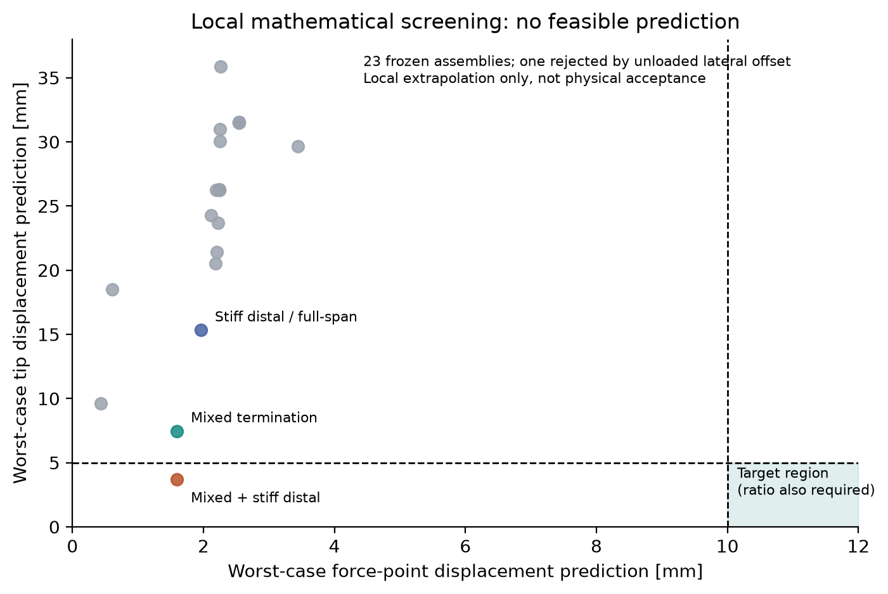

# PHS-2D 第二轮结果：可信平衡已建立，未发现性能可行解

本轮完成原始失败诊断、完整 3D 被动静力求解、数学筛选和独立动力学验证。**P0-A/P0-B 通过，但没有六工况性能通过者，因此没有启用四个预留施力工况，也没有十工况可行性见证。** 旧 P0 仍保持失败封存状态。

独立分支为 `research/phs2d-passive-equilibrium-search`，基线为 `519a798003f841ea44f3521b9cb99b74349abf2d`。新 Study 为 `phs2d-equilibrium-search-20261028-v1`，新 Store 位于该 worktree 的 `runs/phs2d-round2/store`，现已通过原研究链路 STOP。未使用 Provider、仓库 Research Agent、NMPC、PPO 或主动控制，未合并任何主线。

## 可信结论与最佳有效结构

“有效”要求同一数值协议下无载基准及六个独立加载工况全部通过原稳定性与约束标准。排名仅在这样的完整集合中，按最大归一化性能违反量比较；无效候选不参与。

| 数值协议 | 最佳有效装配 | 最小受力点位移 | 最大 tip 位移 | 最大比值 | 最大平面外位移 |
|---|---|---:|---:|---:|---:|
| 原 0.25 ms | D：两全长腱，近软远硬 | 1.962 mm | 15.787 mm | 2.215 | 1.584 mm |
| 明示 0.125 ms | CD：混合终止，近软远硬 | 1.613 mm | 3.896 mm | 1.310 | 0.312 mm |
| 0.0625 ms 最终复核 | 同一 CD 装配 | 1.613 mm | 3.896 mm | 1.310 | 0.312 mm |
| 冻结要求 | 同一结构全部工况 | **≥10 mm** | **≤5 mm** | **≤0.30** | **≤2 mm** |

CD 的 tip 和平面外指标合格，但六个受力点均移动不足，且每个工况的 tip/受力点比值均大于 1。不能把这个较硬、整体侧移的结构称为被动鸡头稳定成功。

CD 的两柔性段均长 0.14 m，每段 12 个单元、两个弯曲自由度/单元；Young 模量分别为 2 MPa、15 MPa。四根腱均从 Base 出发：一对半径 14 mm、终止第一段末端；另一对半径 23 mm、终止第二段末端。每对相位为 π/2、3π/2，段内导向点 s=0.5。固定放绳为 `[0.14, 0.14, 0.294, 0.294] m`，浮点原值见结构文件。未根据外力调整任何长度。

完整截面、密度、阻尼、刚体连接、载荷、网格及各个候选配置见 [structures.json](../../evidence/phs2d_round2_20261028/structures.json)。保留原截面和 10 g 偏心 payload，不借助截面缩小、材料域外软化或改变外力取得改善。

CD 在 0.125 ms 下的六工况：

| 材料 s | 力 / N | 受力点 / mm | tip / mm | 比值 | 平面外 / mm | 有效性 |
|---:|---:|---:|---:|---:|---:|---|
| 0.30 | +0.10 | 1.6129 | 2.1129 | 1.3100 | 0.2029 | 有效失败 |
| 0.30 | −0.10 | 1.6127 | 2.0915 | 1.2969 | 0.2026 | 有效失败 |
| 0.50 | +0.10 | 3.0260 | 3.0960 | 1.0231 | 0.2947 | 有效失败 |
| 0.50 | −0.10 | 3.0251 | 3.0484 | 1.0077 | 0.2936 | 有效失败 |
| 0.70 | +0.10 | 3.5124 | 3.8960 | 1.1092 | 0.3120 | 有效失败 |
| 0.70 | −0.10 | 3.5100 | 3.8931 | 1.1092 | 0.3103 | 有效失败 |

六个加载尾窗最大软静态残差 8.75e−8 N·m，最大关节速度 4.76e−7 rad/s，最大腱长超限 3.034 μm，末帧最大张力 0.897 N，均满足原阈值和 8 N 张力上限。完整尾窗指标、每根腱张力及松弛状态在 summary 和原始记录中。

## 原 P0 诊断与数值复核

旧尾窗只读分析显示：无力基准最大残差发生于 3.84 s，为 1.9711e−4 N·m；尾窗中位数 2.7062e−6、末帧软残差 1.0890e−6 N·m。某条腱在边界附近发生两次张紧/松弛切换，峰值时无活跃约束求解行；其余采样常见 1–2 次求解迭代。没有证据表明当时碰到 Newton 的 100 次迭代上限。高速度坐标主要在远端 36、38、40、42、44、46 号坐标。

旧证据仅以 10 ms 采样；频谱中的 3.846、38.462、50 Hz 不能证明实际高频振荡频率。旧数据没有保存实际 qacc、逐关节静态残差、原始 warmstart 或求解器成本历史，因此不能把 qvel 差分当成原始加速度，也不能断言旧残差一定集中在这些高速度关节。

原静态残差定义包含弹性、重力、材料点外力和 MuJoCo 约束反力，公式本身没有遗漏。它将速度设零后重算 **软约束** 力，不是理想硬绳 KKT 残差。末帧理想乘子拟合残差约 1.12e−6 与软残差约 1.09e−6 是不同量，不应混称。

本轮增加实际 qacc、各广义力向量及冷启动零速度重算。新 C 结构在原步长、s=0.5、+0.1 N 的 3.91 s 记录到 1.9614e−4 N·m 峰值，主要落在 38 号坐标；实际 qacc 最大 437.7 rad/s²，而 qvel 最大仅 2.50e−4 rad/s。冷启动与复制状态得到相同软残差，求解器仅用一次迭代，远端腱距边界约 −0.527 nm。此证据支持边界激活切换和离散积分敏感性，不能归咎于旧 warmstart 本身，也不能把位置几乎不动等同于力学停稳。

将步长从 0.25 减至 0.125 ms 后，C 的六工况均停稳。随后 CD 在 0.125 与 0.0625 ms 下六工况均有效，tip 位移逐工况差异小于 0.1 μm。CD 无载 q 加上 `1e−4*sin(j)` rad 微扰、初速度零的独立复核也停稳。所有版本保持 4 s 观察、0.5 s 平滑加载、10 ms 保存间隔、原阈值及 `solreflimit=[0.004,1]`、`solimplimit=[0.999,0.999,0.001,0.5,2]`；没有调软约束来取得通过。

MuJoCo 的软约束与 `solref`/`solimp` 的含义参见[官方建模文档](https://mujoco.readthedocs.io/en/latest/modeling.html#solver-parameters)。本报告关于具体失稳来源的判断来自保存的本地记录；通用文档不构成这些实验的证据。

## 数学工具与 P0 门槛

新增 `passive_equilibrium_v1` 使用原 48 自由度、原关节刚度和刚体重力：

`Π(q) = 1/2 Σ k_j(q_j−q_spring,j)^2 − Σ m_b g·x_COM,b(q) − F p_F,x(q)`，约束 `ell(q)−Lset ≤ 0`。

SLSQP 使用解析原生一阶导数，统一数值尺度不会改变目标或物理 KKT 标准。求解后独立 NNLS 拟合非负乘子，检查驻点、原始约束、互补、容量、接触、活跃秩和二阶条件。以正乘子约束零空间上的 Hessian 正定作为临界锥上稳定性的充分数值检查；记录 LICQ、严格互补、特征值及条件数，不声称全局最小或解析证明。

Hessian 包括 `−F ∂²p_F,x/∂q²` 及腱几何项。`passive_constrained_compliance_v2` 对正乘子保持局部等式，对零乘子临界约束保留单侧 QP，退化/切换点标记 `nonsmooth_or_degenerate`。加载平衡的 v2 调用也通过，明确计算“原载荷上追加小扰动”的局部响应，不将其他位置追加力误认为移动原载荷后的独立任务结果。

P0-A 完整确认下垂安装、重力、48 坐标、零 actuator、固定上界单侧腱、材料点虚功、约束方向和原生力一致性。P0-B 要求合法无载静力解及独立无载动态支持，不再要求参考两腱结构的所有加载任务合格。原两腱结构两个初值收敛同一分支，KKT 驻点残差 3.095e−9 N·m；无载 4 s 动力学通过原判据。CD 两初值也收敛同一分支，驻点 2.899e−9 N·m，最小约束约化 Hessian 特征值约 0.563，非负无载张力 `[0,0.000572,0,0.008490] N`。

重要接口修复：MuJoCo 的 `ten_J` 使用独立压缩行存储，即使 `mj_isSparse(model)` 对求解器约束返回 false。原全长腱的布局偶然可 reshape；混合终止腱的 144 个条目不能 reshape 为 4×48。现按原生行元数据解码，并加入部分长度腱有限差分回归。仅修复被动研究模块；没有更改既有主动执行模式和 BF2 外力接口。

## 搜索轨迹与结构解释

总计 23 个冻结装配候选，对应 17 个独立原 FamilySpace 结构身份。每个装配均先生成/合法性验证，再求无载平衡和局部柔顺性。覆盖 2/4/6 腱、混合终止、14–23 mm 半径、相位、早终止锚点、沿程半径变化、近远段模量分配、0.08/0.20 至 0.22/0.06 m 长度分配及独立固定放绳。仅沿有明确假设的方向取样，没有进行笛卡尔积或随机动力学搜索。

选择 7 个代表装配进行全部六工况非线性硬绳静力求解，共 42 次加载求解；选择 6 个装配进入真实动力学。原步长公平比较中，A 两全长腱、B 四全长腱、C 混合终止、D 近软远硬均保存完整六工况；A/B/C 含未停稳条件，只有 D 为完整有效失败。渐变半径候选也包含无效工况；CD 原步长无载基准失败，所以没有继续从不合格基准加载。

缩短近段改善 s=0.3 的响应，局部最小受力点预测约 3.44 mm，但非线性六工况仍不能满足目标。收紧 5–50 μm 的全长腱会增加无载偏移和 tip 响应，最小点响应只约 2.54 mm；收紧 200 μm 导致约 7.91 mm 无载偏移，直接淘汰。未扩大预紧域，也未把主动定义中的 `pretension_n` 当作被动施加力。

局部机制可写成 `dq = Z (Zᵀ H Z)⁻¹ Zᵀ J_Fᵀ dF`，仅适用于合格平衡、固定正乘子集合；临界约束需使用实际单侧 QP。改变终止段增加独立长度约束，改变 Z，因此 tip 交叉响应可以降低。远段加硬进一步减少尾端变形，但并未恢复近端受力点柔顺性。CD 的中轴图表现为近段弯曲后远段近似侧移，不能据此宣称已形成有效的 S 形反曲率补偿。

CD 的局部最大 tip 预测约 3.689 mm，非线性硬绳静力约 3.863 mm，独立软约束动力学约 3.896 mm。后两者六工况 tip 最大差约 33.6 μm、受力点最大差约 27.2 μm。静力数学确实帮助筛掉无效结构和选择 CD，但这些误差也表明不能用硬绳数学解替代动态验收。

在已测试的参数方向上，没有新的、有证据支持的性能可行结构假设，因此停止盲目消耗预算。这个停止决定不是整个 FamilySpace 的不可行性证明。未运行成功后才要求的无约束动力学对照、正式任务注册和十工况机理验证；它们不被标记为已完成。

## 预算、失败和交付审计

| 项目 | 实际 | 授权上限/预留 |
|---|---:|---:|
| 积分尝试总数 | 1,744,000 | 8,000,000 |
| P0 | 16,000 | 400,000 |
| P1 | 1,024,000 | 6,800,000 |
| 最终数值复核 | 704,000 | 开始时保护 ≥800,000 |
| 剩余积分额度 | 6,256,000 | 未为耗尽额度而继续 |
| 顶层数学请求 | 94 | 400 |
| 装配候选 | 23（结构身份 17） | 80 |
| 动力学装配 / 原始运行 | 6 / 66 | 装配优先 ≤40 |
| Provider 请求 | 0 | 0 |

已保存内部成本：39,409 次原生 forward、30,642 次目标、30,733 次约束、14,514 次梯度、14,537 次约束 Jacobian、4,368 个 Hessian 列、138 个 QP、10,333 次优化器迭代。另有早期一致性请求漏计的一次直接 forward，单独补充披露，不修改旧 receipt。

两次数学失败保留了顶层收费：第一次求解后 numpy bool 序列化失败，结果数组丢失，内部实际成本未知（两起点优化迭代上界 800）；第二次混合腱 Jacobian 布局异常，内部实际成本未保存。两者均为零积分，已封存为失败；修复后使用显式新请求身份，未重放未知请求、未重置预算。内部成本总数是**已记录部分**，不能冒充完全计量。

原 Store 已有 720 个 artifact 内容哈希核验、184 个 receipt 核验，积分与数学费用和各阶段计数一致。导出重新执行纯评价函数，并验证每个正式加载初态来自相应无载基准、初始 qvel=0、相同装配身份和冻结放绳。预留 s=0.4/0.6 只有普通中轴监测点，没有施加过预留外力或据其调参。

回归：6 个 PHS/被动静力测试，27 个原生外力和 Base-only/跨任务构造测试全部通过；后者使用已有零积分/合成 fixture，不是新科研结果。Reach/Hold、Tracking、主动执行和 BF2 科学实验没有重新运行。

原始 Store 通过原 `core.export` 导出为 tar.gz；因完整记录约 148 MB，按 40 MiB 分为四个可核验分卷，拼接后逐字节还原原归档。详见[证据入口与重建说明](../../evidence/phs2d_round2_20261028/README.md)。原模型 XML、全部装配、协议、失败、状态与事件快照、数学解及每次动力学原始数组均保留。科学运行代码提交身份在每条记录及 `summary.source_commits` 中；最早输出丢失的异常通过失败事件关联其原 reservation。

## 代码范围与后续合并边界

可独立审查的最小代码包括：原生势能/KKT/加载切线模块；部分长度腱 Jacobian 修复；独立放绳接口、P0 分拆及预算请求包装；研究协议/配置；回归和证据导出。被动 kernel 与 MJCF 已补入现有科学依赖哈希列表，后续修改会要求显式绑定迁移。数值比较参数白名单禁止通过覆盖参数修改验收标准，XML 按完整数值协议分目录保存。

由于没有可行性见证，未新增 `task.passive_head_stabilization` 公共登记、正式 evaluator/SELECT 或 Agent 能力，也未准备“成功功能已可合并”的结论。当前代码与负面结果只供审查；没有自动 merge。
