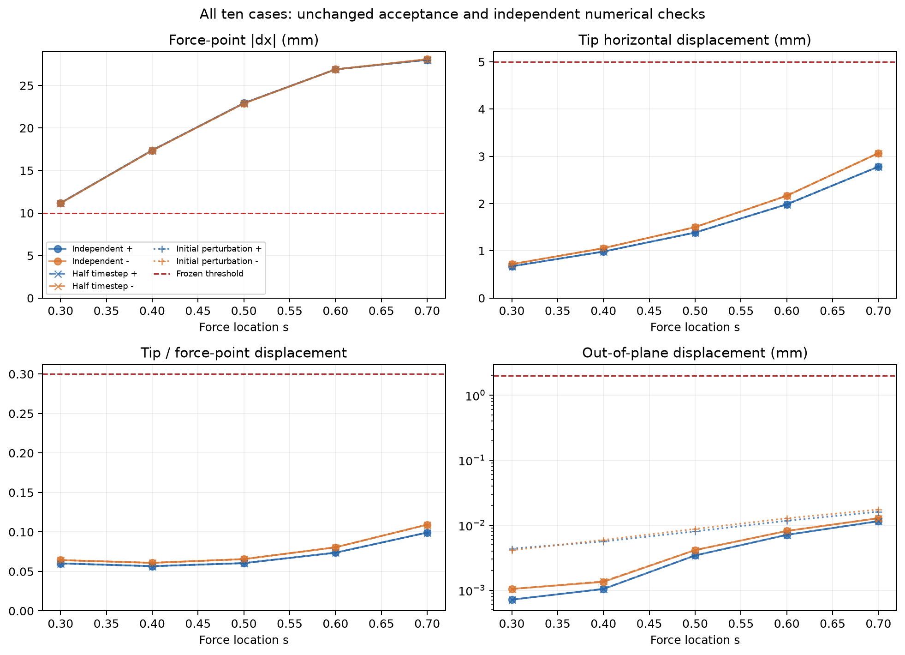
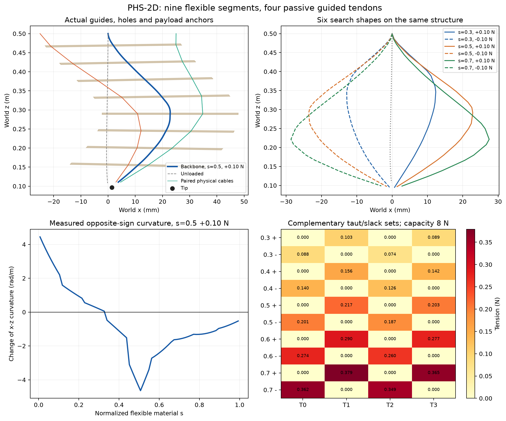
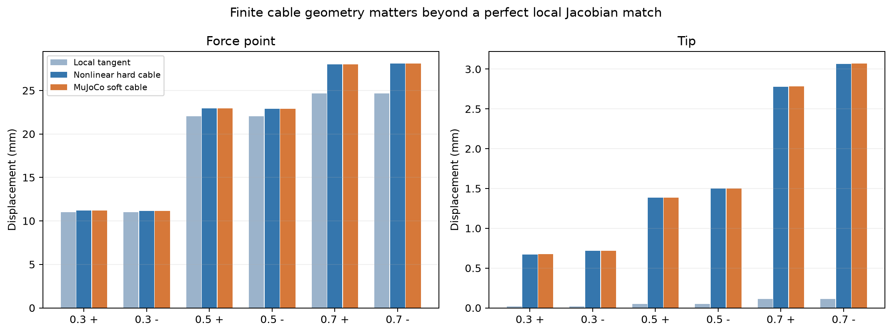

# PHS-2D 第三轮：实体导向板渐变腱路的十工况可行见证

在原 PHS-2D 独立开发 evaluator 下找到可复现的 Base-only 被动结构：六个搜索工况、四个首次启用的预留工况全部通过；独立进程重跑、减半时间步长、无载初态扰动后的十工况也全部通过。这里的通过是原开发任务的数值见证，尚未注册正式 TaskAdapter/SELECT，也不构成硬件性能证明。

研究分支 `research/phs2d-inverse-passive-design` 从远端核对的 `f33648d0bf5fcebbe3d5f5a5878c3198eb32a69c` 建立。第二轮保持 STOP，原 Store 和失败记录未修改；本轮两个版本的 Store 均独立封存。没有合并主线，没有 Provider、Research Agent、NMPC 或 PPO 执行。

## 冻结物理结构

- 九段柔性骨架，每段 0.28/9 m，总柔性材料长度严格 0.28 m；每段八个单元，共 72 个单元、144 个弯曲自由度（每单元两个，保留完整三维运动）。
- 各段圆截面半径 3 mm，Young 模量 8 MPa；近基座第一段密度 1100 kg/m³，其余八段为 1050 kg/m³，保持原材料原型；EI=E*pi*r^4/4，两个主方向均约 0.000508938 N·m²。自然曲率零。
- 固定物理弯曲黏性为每主方向 0.00006 N·m²·s。它是新材料分布设计输入，并非改变积分器阻尼。该值未做真实材料标定。
- 八块原 2 g 导向板、八个原 3 g 连接件、原 10 g 偏心 payload，其质心和完整惯性张量全部保留。总物理质量 0.058356636 kg。
- 柔性材料长度不含刚性间隔；包含八个 14 mm 边界间隔和 14 mm Tip 站点偏移的无变形 Base–Tip 轴向距离是 0.406 m。Base 仍在 z=0.5 m，重力仍为 [0,0,-9.81] m/s²。
- 四根腱仅从同一 fixed_base 出发，通过八块实体板上分别拥有的真实孔，终止于原 payload 实体内部。获胜结构没有柔性段上悬空的偏置导向点，也没有额外世界锚点或直接固定 Tip。
- 基座局部点为 y=±7 mm、z=±25 mm；沿轴向的局部 z 力臂随到 Tip 的剩余距离下降，y 偏置保持 ±7 mm。全部真实 RoutePoint、孔、截面、惯性、网格与 XML 见隔离交付包。
- 四个事先冻结的放绳长度为 `[0.39274245978073885, 0.39274245978073885, 0.39274245978073885, 0.39274245978073885]` m，偏移均为零。全部条件使用相同结构和相同长度向量。配置里的主动 `pretension_n` 初始化字段不在被动 XML 中施加力；实际张力由单侧长度约束产生，XML actuator 数为零。

## 十工况独立复现结果

原门槛：受力点 ≥10 mm，Tip ≤5 mm，比值 ≤0.30，平面外 ≤2 mm；力为 ±0.10 N，4 s 时域、0.5 s 平滑加载和原稳定性、残差、接触标准均保持不变。s=0.4/0.6 未参与设计搜索。

| 材料 s | 力 / N | 受力点 / mm | Tip / mm | 比值 | 平面外 / mm | 状态 |
|---:|---:|---:|---:|---:|---:|---|
| 0.30 | +0.10 | 11.178871 | 0.673055 | 0.060208 | 0.000718 | 通过 |
| 0.30 | -0.10 | 11.155111 | 0.717593 | 0.064329 | 0.001048 | 通过 |
| 0.40 | +0.10 | 17.383839 | 0.984524 | 0.056634 | 0.001043 | 通过 |
| 0.40 | -0.10 | 17.354591 | 1.056705 | 0.060889 | 0.001342 | 通过 |
| 0.50 | +0.10 | 22.922769 | 1.387313 | 0.060521 | 0.003424 | 通过 |
| 0.50 | -0.10 | 22.895662 | 1.502053 | 0.065604 | 0.004145 | 通过 |
| 0.60 | +0.10 | 26.897285 | 1.983575 | 0.073746 | 0.007105 | 通过 |
| 0.60 | -0.10 | 26.890292 | 2.166117 | 0.080554 | 0.008153 | 通过 |
| 0.70 | +0.10 | 28.020974 | 2.781912 | 0.099280 | 0.011531 | 通过 |
| 0.70 | -0.10 | 28.080198 | 3.067948 | 0.109257 | 0.012824 | 通过 |

十工况最大尾窗软静态残差 1.36041e-06 N·m，最大尾窗关节速度 1.2642e-05 rad/s，最大尾窗张力 0.37918 N，最大腱长超限 0.323663 μm。完整逐条件检查、张紧集合和约束行保存于原始 Store。每次加载均由独立无载基准、零速度启动，没有用受载静力解直接初始化动力学。

## 机制证据与数学工具

成功机制是实际渐变力臂腱路、足够密集的实体导向板和反向曲率补偿的组合。它不是仅靠增加整体刚度减小全部运动；最差受力点仍移动超过 11 mm。圆截面各向同性，因此不能把本结果归因于截面各向异性。

基于实际 MuJoCo 腱长 Jacobian，获胜结构在无变形几何姿态的 Tip-x 行空间匹配相对残差约 1.64e-15。Tip-y 行残差约 0.483，不能宣称两条水平行都被腱精确覆盖；实际原横向工况的平面外位移由完整三维平衡与稳定性检查确定。

运动学存在性 A、单侧活跃锥 B 和真实材料点力激发 C 分开输出。局部工具返回 J_tip、J_point、J_length、约束切线 Hessian、秩、正乘子集合、零空间与局部 QP 响应；低维四曲率组只用于机制设计。局部正定性不是全局或硬件证书。

几何 Jacobian 的完美匹配并不足以保证有限位移。真实直线绳段在大变形时会因弦长缩短而松弛；硬绳非线性静力和软约束 MuJoCo 的实际比较均单独保存。原生局部、非线性硬绳、软约束动力学三者没有混作同一结果。

四个腱按 y/z 的四象限镜像布置，正负载荷实际切换不同的正张力集合。所有十工况的中轴均同时出现显著正、负的增量曲率；最小、最大曲率数值及判断阈值保存在 `curvature_evidence.json`。这一结论来自形状和曲率，而非仅凭 Tip 位移小。

`passive_design_sensitivity_v1` 同时微分受载状态和设计相关的无载基准；归一化参数 u=(E−2 MPa)/13 MPa。六个原搜索分支均满足被检查的 LICQ、严格互补、稳定性及 KKT 条件要求。隐式任务梯度对实际重新求平衡的有限差分最大相对误差为 0.1191%。非正则、拓扑变化及材料点绑定切换不返回普通梯度；最大平面外范数只报告方向性有限差分。

| s | 力 / N | d受力点位移/du / mm | dTip位移/du / mm | 最大梯度相对误差 |
|---:|---:|---:|---:|---:|
| 0.70 | -0.10 | -18.1252 | -4.88767 | 0.0608% |
| 0.30 | +0.10 | -6.28343 | -0.825187 | 0.0158% |
| 0.30 | -0.10 | -6.25 | -0.896786 | 0.1191% |
| 0.50 | -0.10 | -10.1429 | -1.53637 | 0.0278% |
| 0.70 | +0.10 | -18.1013 | -4.41197 | 0.0438% |
| 0.50 | +0.10 | -10.1794 | -1.38208 | 0.0298% |

`passive_multicase_design_v1` 用六工况最大归一化违反量做有效性优先比较，比例搜索采用 tip−0.30*point 的等价约束，并保留 point≥10 mm。最终通过仍由原独立 evaluator 的实际比值计算确定。

## 搜索如何改变方向

1. 外置 Base-to-payload 斜拉验证了局部 Tip 行约束，但柔软骨架有限弯曲导致轴向缩短、绳索松弛和部分非法路径。增大同一 Base 上的斜角改善了位移，仍有原 4 s 残差失败。它没有被计为成功类别。
2. 密集渐变导向点使局部模态和非线性性能同时改善。原材料黏性下仍未停稳，因此没有用漂亮位移掩盖无效结果。
3. 冻结 v2 材料域，允许物理弯曲黏性 0.00003–0.0004 N·m²·s；继承并扣除 v1 已消耗的 928000 步、140 次数学请求、18 次候选尝试及 3 个动态装配。密集偏置站点候选可通过六工况，但未被当作最终实体安装答案。
4. 改为只经过实体板孔的三至五段布局，有限弦长松弛仍过大，三段的部分形状还产生穿透。七、九段的成对结构比较改善了有限变形约束；它们同时改变刚性质量和间隔，不能只把改善归因于段数一个变量。
5. 确认九段实际腱路后，联合比较刚度分布和圆截面材料，选择 E=8 MPa 的统一结构。36 单元静力筛选后，在冻结的 72 单元网格上重新完成全部数学和物理验证。
6. 首次十工况通过后，工具禁止再创建搜索装配，只进行本次独立复现、时间步减半和初态扰动验证。没有为耗尽预算继续优化。

逐候选假设、变量、预测、实际观测、预测偏差、成本时间线和剩余额度见 `experiment_journal.json` 及两个完整 Study 导出。工具恢复时保留所有未知输出和费用，没有重发未知执行。

## 独立性、收敛与限制

主积分步长 0.125 ms；减半为 0.0625 ms。扰动是在无载静力初态的全部坐标加入 1e-4*sin(j) rad，初速度为零，再独立积分无载基准和十个载荷。观察时长、软约束参数和阈值均未改变。

| 数值复核 | 最大受力点差 / μm | 最大 Tip 差 / μm | 结果 |
|---|---:|---:|---|
| 减半步长 | 0.00143988 | 0.000195606 | 十工况全部通过 |
| 初态扰动 | 0.000513681 | 0.0226789 | 十工况全部通过 |

`route_geometry_validation_v1` 对实际直线绳段与编译实体凸包进行带绳半径的相交检查，只对拥有的真实导向孔和实体终端锚点作物理例外。获胜结构的无载、静力加载及全部动态保存姿态通过。没有开发通用柔性绳碰撞引擎；连续扫掠、绳间摩擦、自接触、轴向拉伸、剪切、扭转和绳弹性均未被本模型覆盖。现有原型给定导向板质量和惯性，孔位置不重新改写这些给定质量属性。

加密模型最初在 Windows 原生 XML 编译阶段栈溢出。该次零积分数学请求被封存为 output_unavailable，数学费用保留，内部构造成本未知。隔离诊断捕获原生 stack overflow 后，仅本轮被动模型改用 32 MiB 编译线程；XML 和物理方程不变，新版本请求完成验证，未重放旧未知请求。

## 预算与验证

| 资源 | 实际累计 | 上限 |
|---|---:|---:|
| MuJoCo 积分尝试 | 3,456,000 | 20,000,000 |
| 顶层数学请求 | 303 | 1,200 |
| 完整生成尝试（含失败） | 47 | 300 |
| 冻结装配 | 46 | 包含在候选上限内 |
| 动态装配 | 5 | 60 |
| 原始动态运行 | 83 | 步数统一收费 |
| Provider / Research Agent / NMPC / PPO | 0 / 0 / 0 / 0 | 0 |

原始收据、内部计数和原始时间成本随两个 Store 一起封存；全部请求积分费用之和与状态账本一致。一个栈溢出请求的内部构造成本未知，未被伪装为完整已知成本。专项 14 项测试通过。另一次 FamilySpace 相关 21 项回归有 19 项通过、2 项失败；同样的两项失败已在 f33648d 基线副本中复现（旧配置硬编码 hash 和摘要长度断言），没有修改旧断言来制造通过。测试夹具不作为科学候选证据，均无积分、Provider、NMPC 或训练。

完整配置、XML、无载/加载平衡、张力、数学输出、原始轨迹和逐 timestep 数据见 [隔离证据 README](../../evidence/phs2d_round3_20261028/README.md)。通用能力和未来接入建议见 [集成边界](phs2d_round3_integration.md)。所有 Study 已 STOP；没有自动合并主线。
