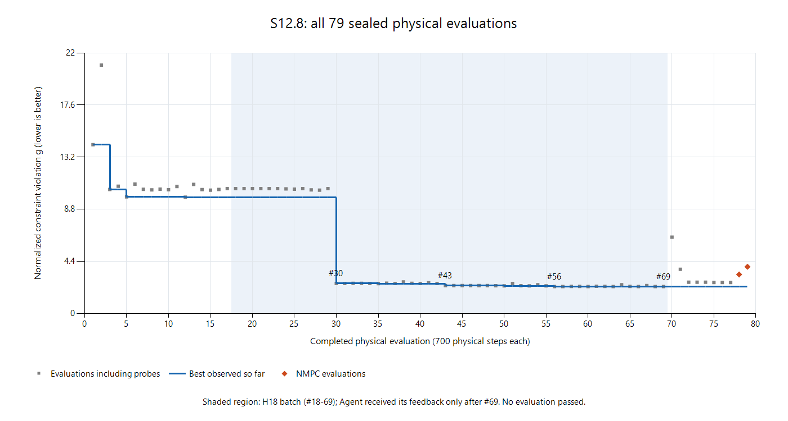

# S12.8-BUDGET：局部控制搜索效率与科研资源分配诊断

2026-10-21；分析分支 `analysis/s128-budget`；基线 `67c8fd9c6e79d5479a0c7ba2def00a44ffe74e70`。

## 结论与范围

S12.8 的问题是**单一物理启动计数不能表达计算成本，加上大批次内部没有 Agent 决策点**，而非缺少新的搜索器。
H18 在一次公开调用内花掉 52/80 个共享物理启动，得到主要改善，但四轮的每评价边际收益下降约 3366 倍。
现有 `iterations=1`、`evaluation_requests`、`active_coefficients` 和已有物理结果作为下一起点，已经足够进行分阶段研究。
建议先增加只读成本与机会成本反馈；另行授权的新 Study 才采用版本化的“方法额度 AND 原共享上限 AND 全局计算约束”。
Agent 仍选择结构、数学分析、局部搜索、NMPC、Direct/Residual PPO、继续或停止；不设方法配额使用率、不要求尝试 RL、不把停滞自动解释为不可行。

本次仅增加本报告、离线分析/绘图脚本和派生证据。未修改正式科学路径、Store、receipt、授权、预算、结果或求解器；
新增 Provider 请求、MuJoCo 执行、NMPC、PPO 训练均为 0。低成本模型决策对照仅作方案设计，未运行。

## 1. 数据、定义与可复核性

权威材料：

- [交付报告](s128_delivery.md)、[研究决策](../../evidence/s128_research/decisions.json)、[设计统计](../../evidence/s128_research/designs.json)。
- [独立验收重建](../../evidence/s128_acceptance/reconstruction.json)、[终态](../../evidence/s128_acceptance/status.json)、[逐请求成本](../../evidence/s128_costs/counts.json)。
- 本地封存 Study `s128-cold-live-20261021` 的完整 SQLite artifacts、events、calls、已发送请求；读取自
  `.worktrees/sorosim-matlab-nmpc/runs/research/s128-cold-live-20261021/`。
  原正式源码身份是 `988acfe3339dc4a55b6a46df7349ed98783ae4ee`，不是本诊断分支的新执行。
- 完整归档 SHA256 `acb3ab8f6cabbdf9239c5bc0e80784dd09356e53a2aa3194873b08d96fc29604`，与原交付一致。
  本次读取的 SQLite 文件 SHA256 `24df37fc6afd4e489cfe957ec01aadac5f6366e63614dd19cdbef3e271522cc6`，分析前后相同。

派生物：

- [79 次评价完整曲线 CSV](../../evidence/s128_budget/evaluation_curve.csv)：每次的原结果引用、事件序号、UTC 时间、方法、候选、
  三项指标、违反量、截至当时最佳值、物理步、时间和最近决策包；失败完整保留。
- [诊断汇总 JSON](../../evidence/s128_budget/diagnostics.json)：逐轮、检查点、方法成本、receipt 汇总、公开动作历时及实际发送验证。
- [只读分析脚本](../../tests/research/s128_budget_diagnostics.py)：只使用 Python 标准库，SQLite `mode=ro&immutable=1` 加 `query_only`，
  无科研执行模块导入。输出目录固定为本分支 `evidence/s128_budget`。仅用于已停止、无待执行事务的封存 Store。
- [离线绘图脚本](../../tests/research/s128_budget_plot.ps1)：使用系统已安装的 Windows Charting 库，只读派生 CSV，生成下方 PNG；无依赖安装。

复现命令（从本 worktree 执行，参数指向本地完整封存目录）：

```powershell
python tests/research/s128_budget_diagnostics.py --store D:/softrobot-agent/.worktrees/sorosim-matlab-nmpc/runs/research/s128-cold-live-20261021
powershell -NoProfile -File tests/research/s128_budget_plot.ps1
```

定义：`g=max(0, terminal_error/.01-1, holding_error/.01-1, holding_speed/.02-1)`，越低越好，0 仍须满足完整原验收。
这是原有 `task_gap` 的排名量，不是优化器目标值，也不代替评价器、输入界限、覆盖和完整性。
原任务时域 0.35 s、控制周期 0.01 s、物理步长 0.0005 s；本轮全部 79 次完整执行各有 700 个实际物理积分步，共 55,300 步。
NMPC 的预测模型积分、优化器迭代和 RL 训练动作须另计，不能塞进这个 700。

下文的“数值秒”是既有记录中的 elapsed wall time，**不是 CPU 秒**。
重放取 worker `boundary.elapsed_s/charged_numerical_s`；NMPC 取包围完整执行的 `numerical_s`。
公开请求至原反馈事件的历时另外列出；二者不能相加。

## 2. 所有物理评价的真实收益曲线



灰点包括全部差分探针，蓝线是累计最佳，橙点是两次 NMPC。浅色范围是 H18；这是事后数据曲线，
其中批内的蓝线改善并非同时已经反馈给 Agent。

下表给出全程最佳违反量阶梯曲线的**全部下降拐点**。两相邻拐点之间保持前值，#69 至 #79 不再改善；
因此配合首末编号即可重建全部 79 点。CSV 同时保存每个探针自身的非单调曲线，未只选提案或成功方向。
累计数值秒仅累加物理评价包围时间，不含此前 NLP、Provider 和未计入的调度成本。

| 物理评价编号 | 截至该点最佳 g | 累计评价数值秒 | 来源 |
|---:|---:|---:|---|
| 1 | 14.245979888 | 1.118 | H7 固定输入 |
| 3 | 10.463818440 | 3.334 | H13 响应初始化基线 |
| 5 | 9.832676008 | 5.599 | H13 探针 |
| 12 | 9.811445610 | 13.367 | H15 探针 |
| 30 | 2.517850554 | 33.479 | H18 第 1 轮提案 |
| 34 | 2.517768468 | 37.964 | H18 探针 |
| 35 | 2.506674375 | 39.070 | H18 探针 |
| 43 | 2.342436428 | 48.049 | H18 第 2 轮提案 |
| 44 | 2.340728677 | 49.148 | H18 探针 |
| 45 | 2.337624518 | 50.259 | H18 探针 |
| 49 | 2.336789086 | 54.725 | H18 探针 |
| 50 | 2.315487360 | 55.866 | H18 探针 |
| 55 | 2.315208957 | 61.505 | H18 探针 |
| 56 | 2.264866817 | 62.606 | H18 第 3 轮提案 |
| 57 | 2.264030276 | 63.731 | H18 探针 |
| 63 | 2.263877909 | 70.459 | H18 探针 |
| 66 | 2.262854299 | 73.810 | H18 探针 |
| 69 | 2.262483224 | 77.150 | H18 第 4 轮提案 |
| 79（终态） | 2.262483224 | 714.772 | 无新最佳；STOP，无 SELECT |

物理评价 #70–79 的自身 g 依次为 6.435158、3.721169、2.627783、2.629194、2.629797、
2.599687、2.601086、2.601704、3.282081、3.934046。
它们包含改变刚度/阻尼、匹配长度的新结构、H28 局部搜索和两次 NMPC；不同结构不能把差值归因于某一个控制因素。

终态最佳 #69 为终点 32.493759 mm、保持最大 32.624590 mm、保持速度 0.065249664 m/s，三项均未达标。
#78 两段 NMPC 位置更好（25.075776 / 28.379867 mm），速度更差（0.085641628 m/s）。
统一 g 更差不等于“没有信息收益”：它揭示了位置与速度的权衡，并产生可用的完整实测控制参考。
79 次全部合法完整、全部未通过；数据不足以证明结构族不可行或未尝试方法无效。

### H18：12 维、48 次差分和 52 次新执行

配置为四个结点 `[0,.12,.25,.35]`，6 腱共 24 个系数，活跃子集
`[0,1,2,6,7,8,12,13,14,18,19,20]`（每结点前三腱），共 12 维。
差分步长 0.1 N，初始信赖半径 2 N，系数界限 8 N，4 轮，最多 60 个评价请求。
实际 53 个 callback = 1 个历史失败基线缓存 + 48 个单边差分 + 4 个提案；新物理评价 #18–69 共 52 次。
8 个无效方向尝试未改变裁剪后输入，没有发起重复物理执行；实际重复输入评价数为 0。

| 轮次 | 新评价编号 | 差分+提案 | 真实积分步 | worker 数值秒 | 轮段总历时 s¹ | 中心 g → 提案 g | 实测改善 Δg | Δg/新评价 |
|---:|---|---:|---:|---:|---:|---|---:|---:|
| 1 | 18–30 | 12+1 | 9,100 | 14.536405 | 93.739438 | 10.540555320 → 2.517850554 | 8.022704766 | 0.617131136 |
| 2 | 31–43 | 12+1 | 9,100 | 14.570086 | 126.220572 | 2.517850554 → 2.342436428 | 0.175414126 | 0.013493394 |
| 3 | 44–56 | 12+1 | 9,100 | 14.557160 | 160.074271 | 2.342436428 → 2.264866817 | 0.077569612 | 0.005966893 |
| 4 | 57–69 | 12+1 | 9,100 | 14.544089 | 190.438645 | 2.264866817 → 2.262483224 | 0.002383593 | 0.000183353 |
| 合计 | 18–69 | 48+4 | 36,400 | 58.207740 | 570.472926 | 10.540555320 → 2.262483224 | 8.278072096 | 0.159193694 |

¹ 轮段历时按事件端点连续切分：公开 H18 请求事件 #720 至第 1 轮提案结果事件，后续取上一轮提案结果至本轮提案结果。
包含缓存、绑定、Store 读写、调度、数值计算；首段还包含初始化，不能解释为纯求解器计时。
末次结果至原反馈另有 0.258338 s，整批总历时 **570.731264 s**（北京时间 14:29:19.122487–14:38:49.853751）。
worker 之外有 **512.523524 s** 未由该批 `charged_numerical_s` 表达。
没有保存各轮 CPU 时间或 SLSQP 独占秒数，不能从总历时反推出它们。

第 1 轮相对**全研究最佳**的改善是 9.811445610−2.517850554=7.293595056，
不是相对所选中心的 8.022704766。选定中心是 #17 的 8 N 失败重放，初值比全局最佳更差；两种基线必须分列。
此后轮端全局改善与表中 Δg 相同；中途探针的改善仍计入完整曲线。

每 worker 秒 Δg 依次为 0.551904331、0.012039334、0.005328623、0.000163887；
若用轮段总历时，下降还更明显。四轮预测改善为 7.982888545、0.197804534、0.079309009、0.002386523，
实际/预测比约 1.0050、0.8868、0.9781、0.9988。
模型在已评价提案处相当吻合，不能因此忽略改善已经接近停滞；`trust_radius()` 只看该比值，
仍把半径 2→3→4.5→6.75→8 N，并不依据单位成本收益停止。

四轮响应秩均为 12，条件数约 9.75×10⁵、2.63×10⁶、3.57×10⁶、1.73×10⁶。
这是缩小活跃子集或检查弱响应方向的理由，不能当作秩亏、不可控或物理不可行证书。
应保留各约束分量；只看速度或只看终点会遗漏位置/速度的竞争。

### H28：已有的小批次能力及截断代价

H28 用末结点两个系数 `[12,13]`，2 轮、6 callback 上限。
1 个缓存基线 + 第 1 轮 2 探针/1 提案 + 第 2 轮 2 探针 = 5 次新评价、3,500 步、5.516038 数值秒。
第 1 轮用 3 次新评价、2,100 步、3.312343 s，把该结构 g 从 2.627783317 降到 2.599686853；
未改善研究全局最佳。第 2 轮仅探针消耗 2.203695 s，来不及评价提案，停于 `evaluation_request_budget`。
公开动作总历时 84.833155 s，其中第 1 轮结果端点在 50.522508 s。
这说明小预算**已经可用**，但 6 callbacks 容不下“基线 + 两轮完整的 2+1”，不能把这个截断当成算法收敛。

## 3. 第 20、30、40、50、60 次评价时到底能看到什么

必须区分三个层次：已经写入 Store 的物理事实、批内确定性搜索器可以使用的事实、Agent 已收到的事实。
这些检查点全部位于 H18 同一公开调用内部。调用开始前只有 17 次物理评价；
最近决策包是事件 **#713**，最佳 g=9.811445610、剩余共享启动 63。
期间**没有新 Provider 请求或 Agent 回合**。下一决策包 **#1247** 才包含整批最佳 2.262483224、剩余 11。
脚本把这两个决策包与实际已发送 HTTP 请求中的 `CURRENT_RESEARCH_PACKET` 解析比较，均一致；
H18 原工具反馈 #1246 的成本与响应摘要也已完整发送，没有被 offload 截断。
这里的“已发送”不等于模型理解或使用了反馈。

| 检查点 | 当时最新评价 g | Store 前缀最佳 g | 已完成 H18 整轮 | H18 已用新评价 / worker秒 | 若此时返回，剩余启动 | Agent 实际新反馈 |
|---:|---:|---:|---:|---|---:|---|
| 20 | 10.538804503 | 9.811445610 | 0 | 3 / 3.352400 | 60 | 尚无批内反馈；仍是 #713 |
| 30 | 2.517850554 | 2.517850554 | 1 | 13 / 14.536405 | 50 | 同上 |
| 40 | 2.517791456 | 2.506674375 | 1 | 23 / 25.671893 | 40 | 同上 |
| 50 | 2.315487360 | 2.315487360 | 2 | 33 / 36.923667 | 30 | 同上 |
| 60 | 2.264920649 | 2.264030276 | 3 | 43 / 48.145514 | 20 | 同上 |

全程累计物理步为 14,000 / 21,000 / 28,000 / 35,000 / 42,000；
对应评价数值秒为 22.295116 / 33.479121 / 44.614610 / 55.866384 / 67.088230。
表中的“若返回”是机会成本反事实，**不是当时存在的 Agent 决策点**，也不是实际已预留给 PPO 的额度。

仅用各前缀证据，可以支持的判断如下；它们是可选择的研究理由，不是唯一正确动作：

- **#20**：仅 3/12 个第一轮差分；尚无完整响应或提案。小变化不足以否定组合方向；
  若有授权，完成一个最小完整批次可获得更明确反馈。不能引用后来第 1 轮的巨大改善或条件数。
- **#30**：首次提案显著改善且实际/预测一致，是继续一轮的有力依据；约束仍未满足。
  可用已经完成的响应谱检查弱方向，选择缩小维度或换起点；不能引用第 2–4 轮停滞来宣称这时必应停止。
- **#40**：第 2 轮只完成 10 个差分，暂时最佳比 #30 好约 0.011176。
  可比较已测列的约束分量；不能当作已验证的完整第 2 轮模型或预知 #43 的提案。
  此时立即切断会放弃本轮已付出的响应采集，是否继续剩余 3 次应由 Agent 衡量。
- **#50**：第 2 轮实测改善 0.175414 已知，约为第 1 轮的 2.19%；第 3 轮仅完成 7 个差分。
  支持更短后续批次、减少活跃维度或转向结构/数学诊断；预测吻合与仍有探针改善也支持完成当前轮。
  不得引用 #56、#69 或尚未进行的 NMPC 来指定方法。
- **#60**：第 3 轮改善 0.077570 已知；第 4 轮只完成 4 个差分，前缀最佳额外降低约 0.000837。
  连续收益衰减及已经测得的弱方向支持停止或缩维，把剩余 20 次留给其它已准入研究；
  但还不能知道第 4 轮最终只改善 0.002384，也不能断言 PPO 或数学路线更有效。

如需要真正分阶段决策，应在 #30、#43、#56 对应的整轮末返回 Agent；
#20/#40/#50/#60 用于诊断信息边界，不建议强行把每个十次评价切成不完整响应。

## 4. 分方法资源成本与现有计量的机会成本偏差

| 方法/动作 | 本轮实际 | 原共享启动 | 实际物理积分步 | 包围评价/worker数值秒 | 公开动作历时 s（可取得时） |
|---|---:|---:|---:|---:|---:|
| 合法结构生成 | 7；另 4 次 invalid | 0 | 0 | `construction_numerical_s`=2.501748 | 未在本分析逐个归并 |
| 直接固定输入重放 | 6 | 6 | 4,200 | 6.676659 | — |
| physical_response 初始化 | 2×(1基线+6腱探针) | 14 | 9,800 | 15.608051 | 26.285619+35.311092 |
| H18 response 搜索 | 4轮、12维 | 52 | 36,400 | 58.207740 | 570.731264 |
| H28 response 搜索 | 1完整轮+2探针、2维 | 5 | 3,500 | 5.516038 | 84.833155 |
| NMPC 两段 | 35更新、完整执行 | 1 | 700 | 283.545405 | 285.351832 |
| NMPC 三段 | 35更新、完整执行 | 1 | 700 | 345.217745 | 347.561604 |
| 离线 NLP | 1次，78次迭代 | 0 | 0 个 MuJoCo 步；模型积分另计 | 212.913517 | 213.683323 |
| 独立数学分析 / BDF / pattern | 0 / 0 / 0 | 0 | 未执行 | 无实测值，不能填预测0 | — |
| Direct / Residual PPO训练 | 0 / 0 | 0 | 0 实际发生 | 0 实际发生；训练耗时未知 | — |
| RL训练后独立评价 | 0 | 0 | 0 实际发生 | 无本轮样本 | — |

重放共 77 次、53,900 步、86.008488 worker 秒；加 NMPC 后 79 次、55,300 步、714.771637 包围评价秒。
H18 占全部启动的 65.82%，却只占评价包围数值秒的 8.14%；两次 NMPC 占启动 2.53%，占该数值秒的 87.97%。
但 H18 自身另有大量公开动作开销，不能据 worker 秒声称它实际只花一分钟。
仅凭输入尺寸、积分步或方法名字，都不足以代表真实成本。

现有 receipt 的完整核对结果：

| 账本 wall_s 来源 | 秒 |
|---|---:|
| Provider 59请求 | 748.588000 |
| 77次重放 | 86.008488 |
| 1次 NLP | 212.913517 |
| NMPC simulation.run 两次 | 625.233000 |
| NMPC evaluation.run 两次 | 0.359000 |
| NMPC control.profile_report 两次 | 0.812000 |
| 合计 | 1,673.914005 |

父 `research.core_plan` 的 wall_s 为 0；H18 不会因其 570.731 s 包围历时另计时间。
Study 真实历时为 2,675.733287 s，与上述账本相差 1,001.819281 s。
差额包含未归账的编排、序列化、Store、决策包和其它等待，不能全部称为 CPU 或纯搜索器开销。
现有查重路径逐次扫描历史结果并读取结果/源/配置，重复校验、事务和反馈生成也是可见的开销候选；
轮段增长支持进一步计时定位，尚无 profiler 证据证明各项分别占多少秒。

`state.numerical_s=992.639448` 也不是第三个可直接累加的总成本：
它恰好包含评价包围秒 714.771637、NLP 212.913517、结构构造 2.501748、
`control_initialization_s` 62.452546。
`seed_control()` 的 finally 计入整个 guided seed 包围时间，而其 14 次内部物理重放已在 `recover()` 加过 15.608051 s；
这部分存在层级重叠。同时 H18 搜索器/Store 的大部分包围成本未进入该数值总量。
`compatibility_preparation_s=0.527628` 又独立存在。新反馈应标注计时层级，不重写这些旧字段或历史 receipt。

### 原计数究竟在限制什么

`config.resolve()` / `state.limits()` 将 `physical_launches=80` 映射为 Store 的 `backend_solves`。
`physical_replay.dispatch()` 每个新重放扣 1；完整 NMPC 执行也扣 1。
`rl.dispatch()` 的 start、continue、resume、evaluate 或实际诊断 replay 都会扣一个共享启动；
`admit_stage()` 另记训练阶段，resume 保留阶段身份，却仍依现行语义记新的启动。
`training_capacity()` 和事务内 `reserve_evaluation()` 要求训练加独立评价原子地容下 2 次，
`backend_capacity()` 保护已经预留的评价。这是正式授权的真实上限，不能用改名称取消它。

因此，把一个共享启动理解为“一次独立评价”会出错：训练阶段包含大量训练动作，尚无独立验收；
NMPC 包含 35 次优化；固定重放只有 35 个输入区间。它是**授权的启动额度**，不是等价计算量。
PPO 已有阶段数、动作总额、单阶段动作和独立评价 episode 等多个分项，并非完全没有方法预算；
缺口在于这些与共享启动、总成本及后续准入的关系没有充分显示。

冻结 PPO 默认 2,048 动作、`n_steps=256`、`n_epochs=10`、batch 64；`align_steps()` 向完整 rollout 上取整，
且至少两个 rollout，即此配置最小 512 动作。
按本任务每动作 20 物理子步，完整执行的默认阶段计划 40,960 步，最小阶段 10,240 步；
单阶段授权动作上限 1,048,576 对应最多 20,971,520 个常规动作物理子步，
总动作上限 4,194,304 对应 83,886,080 步。均为配置推导的上界/计划值，**不是本轮实测**。
数值失败可能使动作只执行部分子步；实际 attempted/completed/uncertain 必须分列。
默认优化器更新最多约 10×(2048/64)=320 个 minibatch steps，提前终止、失败或 KL 停止可减少，CPU 时间未知。
训练后的单次完整独立评价仍需 35 动作/700 步，不能用训练 episode 奖励替代。

终态尚有数学 8、NLP 3、BDF 4、NMPC 2、PPO阶段8、训练动作全部余额，
但共享启动只剩 1，低于新训练加预留评价所需的 2。#78 后只剩 2，若其它条件齐备仍可容下一个训练阶段加评价；
#79 消耗后则不能。不能声称 H18 一结束已封死 PPO：当时仍有 11 个共享启动。
实际结果只说明 Agent 最终把启动用在其它路线上，不说明 PPO 学习效果差。

## 5. 根因与最小兼容方案

根因有四项，分别对应可定位的旧代码边界：

1. **比较单位不一致**：一个 `backend_solves` 同时表示重放、NMPC 完整执行、PPO阶段/恢复/评价；
   `science_fits()` 的布尔值也不能表达“还剩哪些完整研究组合”。
2. **反馈晚于成本锁定**：H18 的 60 请求上限和 4轮在一次调用前选择；53 callbacks 返回前 Agent 无法根据真实边际收益调整。
3. **显示的信息不是参数化准入报价**：`context()` 已写有 response 成本公式和单系数/两结点示例，
   `action_feedback()` 已列前置条件，`decision_budget()` 已显示若干余额；
   但 `decision_brief()` 会压缩动作行，未把这些变成当前请求的成本与消耗后后果。
   RL 行的 `prerequisites_only` 也不等于 `training_capacity()` 已通过。
4. **耗时层级不闭合**：worker、父动作、异步训练、Provider、历史 `numerical_s` 分别计时，有遗漏和重叠；
   高拟合比和满秩响应没有单位成本收益的含义。

### A. 先做反馈层，保留所有原额度语义

新增 `resource_feedback_v1` 只作为已有决策包/工具反馈中的派生视图；旧 Study 缺失该字段照常工作。
不改变 receipt、`MeasuredCost`、Store schema、task acceptance、候选/操作身份，不扩权、不自动预留某种研究方法。
对当前参数化提案和少量可选规模显示同源报价：如“一轮12维”“一轮2维”“单次重放”“一阶段PPO+独立评价”。
报价是无需 worker 的纯计算；Agent 可自由给出其它合法规模，正式 guard 始终最终校验。

可在既有 `budget.py` 增加一个纯 `estimate_action_cost(spec, usage, request, observations)`，
由 context 与原 dispatch 的准入预检共用；不要创建新的 Planner、Agent、预算数据库或科研调度器。
候选/源的读取和绑定复用已有检查。报价必须带状态/时间身份，在正式 reserve 事务内重核剩余额度，
显示结果不能成为绕过并发占用、readiness、任务适用性和引用规则的许可证。

建议统一字段如下（null 表示未知，绝不等于0）：

| 字段 | 含义及复用来源 |
|---|---|
| `version`, `as_of`, `scope`, `basis_refs` | 反馈版本、Store状态/末事件身份、候选/任务/模型/动作参数、估计依据；禁止引用未来样本 |
| `planned.evaluation_callbacks` | baseline、probes、proposal 分项和请求上限；区间/条件明确 |
| `planned.new_physical_launches` | 下界/上界、已知基线缓存；沿用 `schedule_identity`，不把后续未知缓存预先当成免费 |
| `planned.physics_steps` | 物理步 upper/nominal、timestep、动作子步；模型预测积分另列 |
| `planned.method_units` | 数学次数、NLP/BDF次数、NMPC执行、PPO阶段、对齐动作、独立评价episode；复用原限制 |
| `planned.compute_elapsed_s` | 区间、同范围历史来源、估计类型及未覆盖开销；新方法未知；CPU/GPU秒独立为未知 |
| `observed` | 复用 `cost_feedback`、`stage_usage`、receipt、raw.physics_steps、profile updates；区分 attempted/completed/uncertain |
| `timing_scopes` | worker、local_solver、top_level_action、async_training、provider；父子关系；不可直接求和 |
| `marginal_return` | base/previous/global三种 g，分量、Δg/新增评价、Δg/物理步、Δg/实测秒；0成本分母用 null |
| `admission_after` | 当前/消耗后各方法的 count-fit、缺失前提、保护额度、最坏/最好剩余范围；非推荐排序 |
| `information_scope` | 信息增益仅为已获得的响应秩/谱、约束变化和可用参考；未知方法收益 null，不伪造期望收益 |

搜索结果中的 `best`、`start_feedback`、`candidates`、`local_responses`、`trust_radii_n`、
`finite_difference_evaluations`、`cost_feedback` 已有，不复制另一份科学结果。
只增每轮索引/成本/中心及全局收益摘要和包围时间；历史结果可离线派生，无法还原的 solver CPU 秒仍为未知。
`control_seed.directed_inputs()`、`control_correction.constrained_response_step()` 的数学行为无需更改。

### B. 新授权 Study：方法额度加全局计算约束是否应该采用

**应该，但不能把现有80次启动转换成“等价秒”后释放额度。**
方法额度防止单一路线无界扩张；原共享启动保留正式执行授权；全局资源约束覆盖数学、结构生成、搜索开销和训练，
防止只把昂贵工作移到“零物理次数”的分类。
推荐后续显式 `budget_semantics` 新版本 opt-in，冻结并授权后才执行：

```text
admit = existing_authorization_and_guards
        AND existing_shared_launch_cap_and_evaluation_reservations
        AND method_specific_caps
        AND new_global_resource_reservations
```

复用已有数学/NLP/BDF/NMPC/训练阶段/动作/评价episode 限制；局部搜索可先复用单请求 evaluation_requests，
如需累计限制，只加一个 local_control_evaluations 分项，所有父子评价仍共同扣原启动上限。
新全局硬资源建议至少含 `physics_steps`（覆盖训练、评价、诊断重放）和 `science_active_elapsed_s`；
数学模型积分、RHS/根求解/optimizer evaluations 另报，不能冒充 MuJoCo 步。
Provider 调用/operation/输出关闭预留继续原样受限，并显示其时间、tokens，明确全项目开销。

`science_active_elapsed_s` 是计算占用的 wall-time 代理，并非 CPU 时间：以现有 operation_key/阶段身份为归属，
同一个同步科学根动作包围其子 worker、分析、绑定和 Store 开销，只计一次；异步 PPO 阶段按既有 active_seconds 增量计，
去掉与 launcher/status 等嵌套观测的重叠。训练已结束后的独立评价是新根动作。
实现前必须固定这套包含关系，按 operation/receipt 保存 append-only 的资源事实，不能直接把旧 `numerical_s` 当新总成本。
若要声称 CPU/GPU成本，须另有进程/设备测量；当前字段只能写 unknown。

**硬约束不能依赖历史均值当作保证。** 固定步数可在现有 worker 的安全子步边界限制；
时间只能在已有求解/训练安全边界停止并保留失败、未完成或不确定结果，必须给出单个不可中断块的最大超支预留。
对于无可证明上界、又无安全停止边界的求解，硬时间预算不能宣称保证不超：应标为 unknown，
不准入该硬约束，或在新授权中明确允许该单次风险。不能给 null 自动赋0，也不能静默开启计时终止改变旧 count-mode。
这一部分涉及 worker 语义，必须单独实现和验证；反馈层可先落地，不能用一个上下文提示假装已完成全局硬限额。

### C. 原 Store、去重、恢复和历史 Study

- 继续用同一个 Store 的 `reserve/complete/remaining`、原 request_id/operation_key/receipt，
  新资源摘要附在已有状态/事件 artifact，不建第二账本。新硬维度如接入 Store 资源合计，按显式版本扩展同一事务契约。
- 动作成本摘要不是新科学身份。原 schedule/candidate/task/model/seed 绑定与去重保持；
  缓存失败基线不得充当 fresh pass；独立重复验收仍需单独授权和执行。
- 本次 53 callbacks 中1次缓存只计回调，不扣新物理步；缓存仍有读取/计算开销，不能把所有维度都写0。
  相同 request 已有 receipt 返回旧结果，不重复扣费；未完成请求必须恢复，未知外部执行保留原占用。
- 新资源的 reserved→observed 在既有事务与恢复流程内按 operation 身份结算一次。
  已耗成本不因失败、换方法、续训、重启而退款；reservation 是释放未耗部分，不删除历史成本。
  RL `known_consumption_lower_bound/accounted_actions_upper_bound/consumption_uncertain` 原样保留。
- 旧 Study 无新版本时，原 limit、used、remaining、hash、receipt、恢复和 count-mode 判定完全照旧；
  只可显示标注为“历史派生、不可据此重算授权”的新摘要。缺失计时/子步字段为 unknown。
  不用当前可变配置重解释冻结任务，不给已停止 S12.8 补预算或重开研究。
- PPO 独立评价预留先于训练原子准入；确认/关闭预留依冻结协议原样保护。
  数学分析、局部搜索和 RL 可以有不同计数单位，但每条路线都必须落入总计算成本视图及正式授权边界。

## 6. 成本可以预估到什么程度，如何提前显示准入后果

| 动作 | 可准确计算 | 只能给范围/条件 | 必须未知的部分 |
|---|---|---|---|
| 固定重放 | 冻结时域/网格/通道，完整执行700步；已知精确缓存绑定 | 新执行0或1；失败实际子步≤700；fresh验证不得当缓存 | 首次CPU、壁钟；失败发生时点 |
| response搜索 | S起点、d活跃维、I轮的完整名义callbacks=`S+I(d+1)`，再受request cap限制 | clipping、零方向、求解失败、首次pass、缓存使实际更少；新执行按已知缓存扣除后的上界；pattern最坏`S+2dI` | 未来Δg、未来rank、提案成功、精确wall/CPU |
| physical_response种子 | m通道名义1+m次；完整每次700步 | 缓存/无输入空间/首次pass/失败会减少；最终拟合种子仍是unmeasured | 拟合后独立效果、未来运行秒数 |
| 数学分析/NLP/BDF | operation、协议、模型维度、固定网格的名义积分区间、迭代上限（若有） | 自适应步、导数/线搜索/根求解/RHS次数、warm/cold差异 | 全局可行性、无该范围历史的秒数、无法封顶的求解时间 |
| NMPC | 完整35控制更新、700实际物理步；单次启动 | 预测网格/子步给出每次模型积分规模，但求解器评价次数未知；参考同模型同求解器的历史耗时范围 | 首次完整执行秒数、更新失败/恢复、未来任务改善 |
| PPO | `align_steps`对齐动作、阶段/评价预留、每动作20步、固定超参数 | 实际失败子步、rollout/optimizer步骤上界、attempted/completed差异 | 首次吞吐、CPU/GPU秒、学习收益、达到约束所需动作 |
| 独立RL评价 | 单完整episode35动作/700步；单独episode及启动额度 | 失败/未知worker保留区间与占用 | 未执行policy的g、吞吐跨硬件可迁移性 |

公式计算不触发仿真。报价携带 exact/upper_bound/empirical_range/unknown 标签，计划步数不冒充实际消耗。
经验范围只能使用同候选规模、backend、runtime、控制/求解参数和硬件可比的**此前**样本；
样本少时同时列 n 与 min/max，不能包装成置信区间。
在 H18 决策前可以准确报“一轮最多14 callbacks，已知基线缓存时最多13次新物理、9,100步；
四轮最多53 callbacks/52次新物理/36,400步”，而不是只展示“请求上限60”。
前17次重放可以给 worker 吞吐的粗经验范围；首次 response 搜索的总编排时间必须标未知，不能偷用570.731 s。

例如 H18 决策前的只读卡片可显示：

```text
当前 shared launches 63（总授权80，已用17）；数学8，NLP3，BDF4，NMPC4，PPO阶段8。
候选方案（Agent任选规模）：
  response, d=12, iterations=1: callbacks≤14；新启动≤13；物理步≤9100。
  response, d=12, iterations=4: callbacks≤53；新启动≤52；物理步≤36400。
  response, d=2, iterations=1:  callbacks≤4；新启动≤3；物理步≤2100。
按上界消耗后 shared 分别≥50 / ≥11 / ≥60；不是自动给任何方法预留。
新PPO阶段+独立评价至少需要2个shared，另需对齐动作、训练阶段和episode额度及原preflight。
worker时间仅有此前重放经验；该搜索总wall及CPU未知；改善未知。
```

卡片还应显示“再耗费多少将改变准入”，如剩余 2 时一个新重放/NMPC 会使剩余降到1，
从而使未预留的新 PPO 训练+独立评价 count-fit 由真变假；若已持有某阶段评价预留，
则按 `backend_capacity` 的可支配值计算，不能挪用其1个启动。
方法计数够用与全部前置条件通过分开显示；本例不声称 PPO 一定可启动或有更高收益。
操作预算也须包含父公开操作、内部评价操作和关闭需求，复用现有准入公式，不编造“所有方法都只用1次tool”。

## 7. 分阶段反馈不需要重新实现搜索器

已有 `LocalControlSearchSettings` 允许 `iterations>=1`、`evaluation_requests>=1`、v2活跃子集。
`search()` 返回所有 probes/proposals 的合法性排名、最佳引用及源、预测/实测改善、响应谱和停止原因。
`dispatch()` 从已完成物理结果的 source 接续；`evaluate_schedule()` 与 Store 复用精确历史序列。
因此可由 Agent 请求一轮，读反馈，再用 best.source 作为新 start，明确选择新半径、活跃子集和有限预算。
无需增加在线 Planner、求解器状态数据库、自动切换规则或新的搜索实现。

一个已知缓存单起点、d维完整单轮应允许 `evaluation_requests>=d+2`：
baseline callback仍占1，即使新物理成本0；d个差分加1个提案再占d+1。
若 cap 只够部分差分，应预先显示“无法完成一轮”，仍允许 Agent 有理由地只采集局部信息。
`additional_starts` 的 baseline 也消耗callback；`iterations` 是在各start之间轮转的总轮数，
不能把它误算成每个start都做I轮。

分批重设起点会把系数零点移到新控制源，默认信赖半径会重置，原系数界限相对原start的可达域也可能改变；
它不保证与一次4轮搜索数值等价。需在反馈中明确 rebase、保留源链与物理输入界限；
“沿同request恢复”则重放确定性编排并复用已完成receipt，不能把这两种情况混同。
数值计算若需重算仍有成本，缓存不是所有资源免费。

## 8. 建议改哪些已有函数、预计规模与一致性测试

以下是**后续实现建议**，本分支未改这些函数。规模为人工估算的净新增/调整行数，不是承诺。

| 现有位置/函数 | 最小改动 | 阶段及预计行数 |
|---|---|---:|
| `budget.py`: `decision_budget`, `backend_capacity`, `science_fits`, `reserve_evaluation`, `capacity` | 新增纯报价/消耗后方法count-fit，复用预留与准入原因，不把fit等同全部前提通过 | A 70–110 |
| `local_control_search.py`: `search`, `dispatch` | 复用rows提炼逐轮成本/改善、补求解器及整批包围计时；不改搜索行为 | A 35–60 |
| `physical_replay.py`: `seed_control`, `guided_seed`, `evaluate_schedule`, `recover` | 复用原步数/receipt；新增明确包含关系的计时摘要，保留旧字段；精确缓存报价 | A 20–40 |
| `rl.py`: `align_steps`, `training_capacity`, `allocation_feedback`, `reconcile`, `dispatch` | 对齐动作/实际子步/独立评价预留和消耗后训练准入摘要；不改变训练设置或resume收费 | A 25–45 |
| `research_context.py`: `action_feedback`, `context`, `compact_evidence`, `decision_brief`, `tool_feedback` | 将报价、最后完整轮和机会成本卡片真正保留到Provider可见层；有界摘要并可读原始artifact | A 45–75 |
| `agent.py`: `decision_packet`、已有请求前hook | 原注入路径复用；不需要新Agent或系统提示里的方法偏好 | A 0–10 |
| `control_seed.py`: `directed_inputs`；`control_correction.py`: `constrained_response_step` | 无算法修改；若计时由caller包围即可 | 0 |
| `config.py`: `resolve`；`state.py`: `limits`；`platform_store.py`: `reserve/complete/remaining` | 新授权版本资源维度/保留/结算，legacy序列化不变、事务检查同源 | B 80–140 |
| `execution.py`、`analysis.py`、`mechanics.py`及原worker安全边界 | 数学、NMPC、训练、结构和编排根动作成本归属；step硬上限及时间超支策略 | B 100–180 |

A约195–340行生产变动，预算/反馈一致性测试约140–220行；
B在A之外约180–320行加约120–200行测试，若求解器缺乏可中断边界可能更多，必须先明确支持范围。
不要为了满足行数目标隐去未知成本或增加第二资源系统。
对局部历史查重循环的性能优化暂不列为科学路径必改项；先加范围清晰的计时再定位，
不能借本诊断改去重语义。纯函数/进程内临时索引若后续采用，仍由原 Store receipt 决定真实执行。

建议扩展已有 `test_local_control_search.py`、`test_count_continuation.py`、`test_rl_integration.py`、
`test_s127_layered_context.py` 与已有中断场景，不新建庞大Harness。必要测试为：

1. 单轮d=1/2/12、多start、缓存baseline、裁剪无效方向、首次pass、cap中途截断：报价上界覆盖真实callbacks/新启动/步数。
   使用明确标注的合成回调，不做MuJoCo执行。callback上限与新启动上限不能混淆。
2. 同源报价与真实guard在剩余0/1/2、持有RL评价预留、stage/episode/action耗尽、protected关闭边界处一致。
   剩余2→消耗1后，新阶段+独立评价不能fit；既有reserved评价不被挪走；数学额度仍按原语义。
3. 动作向rollout上取整、两rollout最小值、单阶段/累计上限同时检查；resume保留stage但保留旧启动收费；
   uncertain consumption使用上下界，status多次读取不能重复加实际消耗。
4. 相同request重试、receipt完成前后中断、worker未知终止：不重复物理扣费、不释放未知占用、不重启外部执行。
   独立验收仍需fresh、原frozen任务和完整protocol；缓存失败不获得fresh pass。
5. nested seed/replay、NMPC updates、异步PPO/status、Provider在新资源视图中只按定义计一次；
   旧receipt/state历史值逐字保留，新时钟不可混同旧wall_s；缺字段不得当0。
6. legacy配置不出现新hard字段、不重算limit/used/hash；缺版本恢复原count-mode。
   新版本也不能突破旧shared授权、方法上限、operation/provider关闭预留。
7. `decision_brief()` 真正保留报价、收益与after-admission；截断/摘要/证据读取不丢关键机会成本和未知标签。
   只改变反馈不应改变科学身份、原始采样或验收；不在测试中调用Provider。
8. 仅对新版本：全局步数/时间资源多维事务预留、余量释放、失败消耗保留、跨进程恢复和不可中断块超支边界。
   未知成本不能准入硬界限；预估不得取代实际结算。

## 9. 低成本、独立的决策对照方案

新增信息是否改变 Agent 选择，不能由“提示变长”或本次事后解释来证明。
本阶段完成数据截面与准入边界的离线重建，**没有进行新Provider决策实验**；
下面是下一次单独授权时可直接使用的预注册方案。

选择三个真实决策切面：H18前（17次评价）、H18后/H19前（69次）、H28后/H29前（77次）。
它们是已存在的请求边界，优先于人为#20/#40等批内切面。
每个切面从此前Store事件和实际发送请求重建可见输入，剥离后续结果；不让模型读本报告的完整曲线或未来NMPC。
如另研究分阶段批次，用#30/#43/#56此前数组构造并显式标注“模拟返回切面”，不能冒称历史Agent已收到。

在相同模型配置、同一冻结任务/历史和同样工具schema下，独立上下文只要求输出一个typed decision及有限规模：
继续当前搜索/改变活跃系数与轮数/数学/结构/NMPC/Direct或Residual PPO/STOP均可；
返回的任何工具调用仅捕获为决策数据，**不执行**。
三组为：A原反馈；B资源与边际收益/准入后果卡；C等token长度的中性既有事实重述。
使用实际tokenizer匹配长度（先做离线序列化长度检查），不把新增信息藏在更大的历史窗口中。
三切面×三组×两次独立重复=18次单轮请求，先小样本；实际token/费用上限需事先授权，
不因输出不合预期自动重试，也不续开科研或训练。

预先定义观察量：选定方法、`iterations/active_coefficients/evaluation_requests`、对齐训练动作、
按最坏成本消耗后的可用路线、是否误用future/训练奖励当验收、typed合法率。
主比较为同切面B对A及B对C的配对决策变化；记录原始选择分布和具体规模，不把“选RL”或“更快STOP”定义为正确答案。
可盲化组标签由独立审阅者检查决策是否引用了真实边际收益和授权约束；不评判未经执行的方法谁更有效。
两次重复只作pilot描述，不能给出稳定因果效应或科研成功率结论。

信息操纵检查可先完全离线完成：卡片的#17余额63、#69余额11、#77余额3；
在#77两次额外新启动会把剩余降到1，关闭新训练+评价组合；消耗0则保留。
这验证新增字段能准确表达机会成本，不等于已经证明模型会据此改变选择。
若B与C同样改变，只能说明上下文扰动可能起作用；若B稳定改变成本相关规模且C没有，才有继续扩大对照的理由。
不以这些不执行的单步决策预测最终收敛，不把任何固定方法偏好写回正式Agent。

## 10. 本分支实际验证记录

只读脚本实际运行通过：79个不同完整物理结果与独立重建逐项对应；
原三指标推导的g与封存task_gap一致；实际物理步合计55,300；
两批搜索callback/cache/new-evaluation/数值秒核对一致；全部receipt汇总wall_s与原账本1,673.914005 s一致，启动合计79；
H18批内无新Provider请求；前后决策包匹配真实已发送wire，整批反馈完整发送；
归档hash匹配原交付，SQLite分析前后文件hash不变。

本次只运行离线脚本及文档/差异检查，没有运行会触发模型、积分器、优化器或训练的回归/研究入口。
新增证据属于历史派生诊断，不建立新的物理成功、方法优劣或可行性结论。
