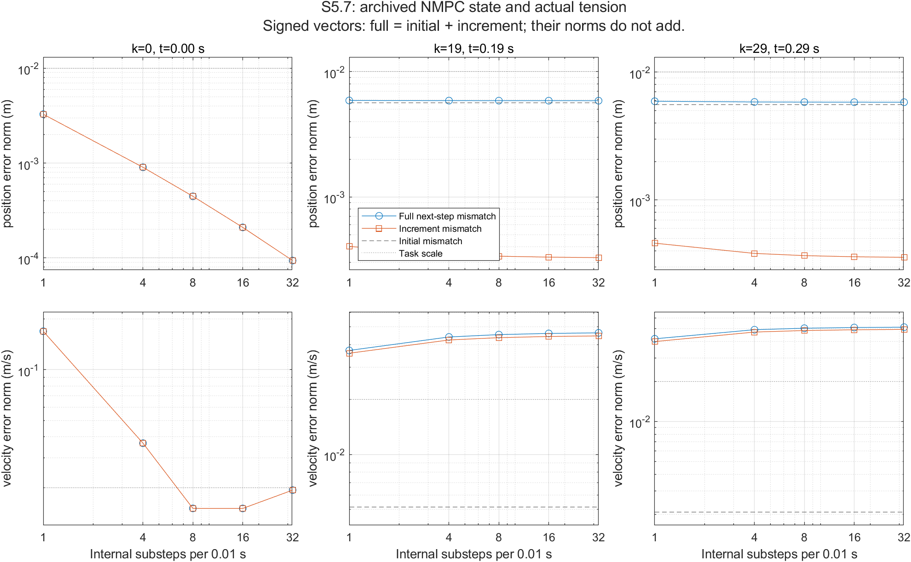

# S5.7 archived NMPC prediction diagnosis

The original 0.35 s reach/hold task remains frozen. This milestone uses archived
MuJoCo observations and new, fixed-action SoRoSim integrations lasting exactly
one 0.01 s control interval. It performs no new physical evaluation and makes
no new task-pass, real-time, optimizer-optimality or RL claim.


The evidence supports a numerical-discretization contribution at t=0, material
initial representation offsets at later NMPC states, and persistent late
incremental response disagreement. All three archived accepted predictions
reproduce at the original resolution. The recommended next major direction is
**E ? Further discriminating diagnosis**, specifically the MuJoCo-only
projection reconstruction audit of these exact late NMPC states. This is not a
unique physical cause attribution.

## Source, implementation and scientific binding

Repository/branch: `wran021004-gif/softrobot-agent`,
`feat/sorosim-matlab-nmpc`. Starting Git SHA:
`fdf0ae0c0aacd69ea4d10749eade70c27c13fa95`.
Initial admission implementation: `0aac7c1787aab8cb0b1c35f9a98e64bc697892fe`.
Actual integration source freeze: `6bc064d39577ccb8b4508a7cb7e17abb081cef1d`.
The final delivery commit is the commit containing this report and the audit;
its exact local/remote SHA is returned with the delivery rather than embedded
as a self-referential file hash.

The new archive-only `nmpc_prediction_diagnostic` action extends the existing
`python -m tools.research` Host/Store/Plan and contained mechanics worker.
`numerics.execution_source/archived` verify historical archive/member hashes;
`gvs_projection.project` checks archived projected states against saved physical
joint states; `matched_state._vectors` supplies the signed vector decomposition.
`SorosimModel.convert` and the experiment-owned `SorosimSession` preserve the
candidate/model and Engine lifecycle. MATLAB `sr_diagnose('fixed_sequence')`,
`sr_derivatives`, `sr_dynamics`, routing and upstream dynamics are reused without
changes. No integrator, physical kernel, task, controller policy, PPO route,
second framework or provider session was added.

The actual pinned checkout `runs/SoRoSim-pinned` is clean at
`24d573a3e864ffda87c42ee462a6ed620133cc7b`; each Engine independently checks its
eligible upstream source/MEX hashes and MATLAB R2024a environment. The existing
session environment probe runs a scalar `fmincon` smoke test. These setup probes
are not robot full-horizon NLPs and are included in recorded worker time.

## Exact archived intervals and action alignment

Primary S5.6 source study `sorosim-s56-physics-20261017`, execution
`d2fcde2fe1f9413b8584cfae8dbfae5c`, result artifact
`96615db5434bdf07196a3150afc909e4b68a2ddc397c6cf36c08bdd52a4016ea`.
Historical candidate artifact:
`9e529a8da1e147b8e8e8c42e52fe471bedaa986f008ca2769d6cba28f4ea0631`.
Mathematical model:
`8f8eceb5f74d4b171c87f333db4db0f353aad051b375ff26aca795f7ac1fbaf2`.
Effective task:
`882b3493037dcc8f8da294b3473e1223f0465e92c35bc3064bfc42d467bf212e`.
Physical model:
`bd0371aad5cdc49b4e074ac130fb27ed12d86b8b6bfcbc2ee9450ab6857d798f`.

The immutable source index records the complete 24-dimensional projected state,
12-coordinate order and resolved structural-linear basis, pre/post world output,
requested/selected/applied actions, prediction provenance, source file hashes,
sampling phase and projection residuals. Tendon channels are `tendon_0` through
`tendon_3`, in that order, with physical bounds [0,8] N independently.

Integer index k selects observation/command k and physical target k+1. Both
saved physical trajectory and motion arrays begin at .01 s, so their array k is
the target for command k; the pre-step motion for k>0 is array k-1. At k=0 the
archived pre-step controller observation supplies position and the archived
zero physical joint rates imply exactly zero world tip velocity. This is
explicitly labeled reconstruction metadata, not a newly measured sample.
No floating-point division reconstructs step counts. Requested and selected
first actions equal applied tensions within 1e-12 N in all three chosen cases.
All have accepted plans. The .34 s fallback is excluded.

## Error semantics and numerical evidence

For position and velocity separately, all reported differences are signed world
vectors: initial = S(start)-M(start); one-step = S(end)-M(end);
increment = [S(end)-S(start)]-[M(end)-M(start)]. The audit checks
one-step = initial + increment numerically. Their norms are never added as
independent scalar contributions. Grid differences use S(end,N)-S(end,finer),
including the explicitly labeled 1-to-4 jump.

The declared engineering screen is a 16-to-32 output difference below .001 m
and .002 m/s, 10% of frozen task scales .010 m and .020 m/s. A passed screen
provides neither a continuous-time error bound nor a proof of convergence.
The saved root records retain every exit flag, full implicit residual, iteration
and function-evaluation count, state and output. The full residual has scaled
kinematic and force blocks; it is not an unscaled force norm. Force residuals
remain separately recorded. A numerical failure would remain inconclusive.

## Measured multi-resolution results

All 15 integrations completed. Tables report Euclidean vector norms, in meters
and m/s; full signed vectors and actual end-output vectors are preserved in the
referenced raw results. The .00 s source is an actual NMPC archive, even though
its frozen zero initial state also happens to match the historical task start.
No S4.5 initial state was substituted.

| k / start s | Actual applied tensions, tendon_0..3 (N) |
|---|---|
| 0 / .00 | [0, 1.8430841493041108, 8, 8] |
| 19 / .19 | [1.0885723764070794, 1.5557003513164727, 2.182684698382576, 3.527668511458083] |
| 29 / .29 | [1.6547036870746543, 1.299119585860078, 2.380105633319783, 3.13656348384685] |

| Start s | Substeps | Full position m | Full velocity m/s | Increment position m | Increment velocity m/s |
|---:|---:|---:|---:|---:|---:|
| 0.00 | 1 | 0.003276853 | 0.168852444 | 0.003276853 | 0.168852444 |
| 0.00 | 4 | 0.000903311 | 0.036695511 | 0.000903311 | 0.036695511 |
| 0.00 | 8 | 0.000447095 | 0.015083739 | 0.000447095 | 0.015083739 |
| 0.00 | 16 | 0.000210176 | 0.015073704 | 0.000210176 | 0.015073704 |
| 0.00 | 32 | 0.000093981 | 0.019350887 | 0.000093981 | 0.019350887 |
| 0.19 | 1 | 0.005889626 | 0.037107959 | 0.000402049 | 0.035814231 |
| 0.19 | 4 | 0.005875456 | 0.043961825 | 0.000347002 | 0.042324030 |
| 0.19 | 8 | 0.005870592 | 0.045288211 | 0.000335887 | 0.043586698 |
| 0.19 | 16 | 0.005867862 | 0.045964412 | 0.000330128 | 0.044230449 |
| 0.19 | 32 | 0.005866425 | 0.046304060 | 0.000327206 | 0.044553768 |
| 0.29 | 1 | 0.005909617 | 0.041797232 | 0.000460116 | 0.039840659 |
| 0.29 | 4 | 0.005835602 | 0.048936732 | 0.000382688 | 0.046981182 |
| 0.29 | 8 | 0.005820780 | 0.050206123 | 0.000367805 | 0.048250986 |
| 0.29 | 16 | 0.005813171 | 0.050831380 | 0.000360305 | 0.048876431 |
| 0.29 | 32 | 0.005809332 | 0.051138758 | 0.000356565 | 0.049183888 |

The initial position/velocity norms are respectively:
(.00 s) 1.67e-16 m / 0 m/s; (.19 s) .005642278 m / .005155644 m/s;
(.29 s) .005549454 m / .002081320 m/s. The corresponding curvature/rate
least-squares maxima are 0/0, 6.163772/10.378582 and 6.870140/7.089527 in
rad/m and rad/m/s. These quantities have different physical meanings.

| Start s | Initial position vector m | Initial velocity vector m/s |
|---:|---|---|
| .00 | [1.67e-16, 0, 0] | [0, 0, 0] |
| .19 | [.004269741, -.001401877, -.003411650] | [.002308083, -.003980033, .002326534] |
| .29 | [.004230164, -.001228925, -.003375189] | [.001851487, .000920693, -.000237097] |

At N=32, the incremental position/velocity vectors are:
.00 s `[-.000037356,.000038767,.000077033]` /
`[-.009748521,.009555096,.013715805]`;
.19 s `[.000324534,.000024691,.000033641]` /
`[.043673962,.008808024,.000204881]`;
.29 s `[.000351745,.000058419,.000001116]` /
`[.048848055,.005605822,-.001223584]`.
The exact unrounded vector identities pass to 1e-15 in the independent audit.

| Start s | Grid comparison | Position difference m | Velocity difference m/s |
|---:|---|---:|---:|
| 0.00 | 1 to 4 | 0.002374501 | 0.136056269 |
| 0.00 | 4 to 8 | 0.000457253 | 0.027613136 |
| 0.00 | 8 to 16 | 0.000239435 | 0.014194879 |
| 0.00 | 16 to 32 | 0.000122736 | 0.007160190 |
| 0.19 | 1 to 4 | 0.000069987 | 0.007331777 |
| 0.19 | 4 to 8 | 0.000012734 | 0.001434382 |
| 0.19 | 8 to 16 | 0.000006435 | 0.000734058 |
| 0.19 | 16 to 32 | 0.000003226 | 0.000369566 |
| 0.29 | 1 to 4 | 0.000080721 | 0.007156092 |
| 0.29 | 4 to 8 | 0.000015965 | 0.001277181 |
| 0.29 | 8 to 16 | 0.000008159 | 0.000630384 |
| 0.29 | 16 to 32 | 0.000004106 | 0.000310348 |

All observed successive grid-difference norms decrease for both outputs and
all checkpoints. At .00 s the 16/32 position/velocity changes are 1.227% / 35.801%
of task scales: only position passes the 10% screen. At .19 s they are
.0323% / 1.8478%, and at .29 s .0411% / 1.5517%: both late checkpoints pass.
This is finite-grid screening, not certified integration error.
No 64-substep local calculation was run under the frozen 15-integration grant.

At .00 s, position mismatch decreases 34.87-fold from N=1 to N=32 and velocity
mismatch 8.73-fold. However, velocity error is smallest near N=8/16, then grows
to .019350887 m/s at N=32; a numerically refined solution need not approach
MuJoCo monotonically. At .19/.29 s, fine-grid position mismatch remains
.005866425/.005809332 m, while velocity mismatch grows to
.046304060/.051138758 m/s. The late position increments are only
.000327206/.000356565 m; initial offsets dominate that comparison in magnitude,
without implying additive scalar shares. Late incremental velocity differences
are .044553768/.049183888 m/s, 2.228/2.459 holding-speed scales. Numerical
stabilization supports response-model disagreement but leaves projection-induced
state loss and different kinematics as confounders.

| Start s | Fresh N=1 minus archived prediction: position norm m | Velocity norm m/s | Max native state-coordinate difference |
|---:|---:|---:|---:|
| .00 | 6.444e-17 | 1.685e-15 | 4.718e-12 |
| .19 | 1.112e-16 | 4.141e-15 | 1.233e-12 |
| .29 | 2.861e-17 | 3.893e-15 | 1.198e-12 |

All comparisons use the same initial projected state, same accepted/applied
first action, implicit Euler and original one-substep sampling. The original
SQP selected nodes and freshly solved roots agree in the physical output space;
no indexing, recovery-selection or replay inconsistency is detected here.
The mixed q/qdot coordinate maximum has native coordinate units and is not a
48-joint physical-state error.

| Start s | S5-B archived position / velocity mismatch | S5.6 archived position / velocity mismatch |
|---:|---|---|
| .00 | .003276853 m / .168852444 m/s | .003276853 m / .168852444 m/s |
| .19 | .005904641 m / .037951062 m/s | .005889626 m / .037107959 m/s |
| .29 | .005566666 m / .055554742 m/s | .005909617 m / .041797232 m/s |

Earlier braking slightly improves the archived .19 velocity discrepancy and
reduces the .29 velocity discrepancy, while the .29 position discrepancy grows.
Because post-intervention states and commands differ, these are observations
on two trajectories, not causal same-state comparisons or controller ranking.



## Projection and physical response limitations

Initial cross-model output mismatch includes projection and different
kinematics. Joint-curvature/rate least-squares residuals use rad/m and rad/m/s;
they are not world tip errors. There is no archived MuJoCo-only reconstructed
world-tip residual for these later NMPC states. Historical S5.5 did obtain such
residuals for different S5-A fixed-command states: .006075352 m/.119151954 m/s
at .15 s and .002142289 m/.042359836 m/s at .29 s. Those values cannot be
transferred to the current closed-loop checkpoints.

## Earlier braking and historical trajectory accumulation

Read-only S5-B comparison uses study `sorosim-s5b-nmpc-20261016`, execution
`99b7a479d8a7423287c000fa7d54eece`, result artifact
`bb8506acc88494094afe1bdd8c5559f0c9709d4ec9b958ddfcff8f2d2413fb81`.
The scientific configuration comparison finds exactly one difference:
`holding_brake_lead_s`, 0 to .02. First applied-control divergence is index 18,
at .18 s. The .19 and .29 projected states differ between executions; every
archived prediction is compared with its own following physical sample.
No physical same-state counterfactual or controller-superiority result exists.

S5.6 holding speed first exceeds .020 m/s at .33 s and reaches .041814094 m/s
at .35 s (2.0907 task scales). S5-B first exceeds it at .30 s and reaches
.042351326 m/s at .35 s. Both historical tasks fail, retain the unusable final
update, and demonstrate no real-time performance. The repaired final clock
boundary has not been re-evaluated by a complete physical rollout here.

Historical S5-A accumulated maxima were .056479582 m and 1.299509910 m/s.
S5.5 matched-state checks at .15/.29 used different fixed commands and states,
and even re-executed a physical prefix; S5.7 uses actual NMPC states and no
physical prefix. The historical S4.5 fixed-command trajectory reaches holding
speeds .791913/.827020/.844771 m/s at 16/32/64 substeps. Its full-horizon
discretization sensitivity is corroborating context, not a substitute for the
local NMPC calculations. Long-horizon versus local comparisons support a
history contribution but cannot assign a unique additive causal share.

## Hypotheses and next scientific direction

The versioned feedback packet records support, weakening evidence, resolution,
confounders and the smallest next experiment for each hypothesis:

- **H1, coarse integration:** supported at .00 s by the 34.87-fold position and
  8.73-fold velocity improvements. Weakened as a universal explanation by late
  velocity mismatch increasing with refinement. The .00 s velocity grid remains
  material; one explicit 64-substep check is the smallest numerical follow-up.
- **H2, representation:** supported by the .19/.29 initial offsets of 5.642/5.549
  mm, versus final 5.866/5.809 mm. Weakened at .00 s by essentially zero initial
  offset. Pure least-squares loss versus cross-model kinematics remains unresolved;
  audit MuJoCo-only forward kinematics of the exact projected/reconstructed states.
- **H3, response:** supported by late N=32 incremental velocity differences
  .044554/.049184 m/s and much smaller 16/32 grid changes .000370/.000310 m/s.
  Weakened as an intrinsic calibration claim by projected state loss and initial
  offsets. After representation qualification, a separately authorized same-state
  representable-state response probe can further distinguish dynamics.
- **H4, accumulation:** qualitatively supported by historical .05648 m / 1.29951
  m/s open-loop maxima versus these local errors; weakened as a quantitative
  attribution by different controls/histories and already material local mismatch.
  No unique scalar share is identified. A short declared prefix, after resolving
  local fidelity, would be smaller than another full campaign.
- **H5, prediction/replay inconsistency:** not supported in these three accepted
  plans; maximum physical output disagreements are 1.12e-16 m / 4.15e-15 m/s.
  This resolves consistency for these cases only. The fallback and other accepted
  recovery-selected cases remain outside the test; repeating these three adds
  little information.

**Select E ? Further discriminating diagnosis.** The next concrete experiment is
an archive-bound MuJoCo-only projection/discretization forward-kinematic audit
at S5.6 k=19 and k=29, with zero physics steps and zero NLPs. Compare the signed
within-MuJoCo reconstruction errors against S5.7's cross-model initial vectors.
It is nonduplicate: S5.5 audited different S5-A fixed-command states; S5.7 did not
produce these NMPC states' MuJoCo-only world reconstruction residuals. This can
separate pure representation loss from cross-model kinematics before calibrating
dynamics or spending another full NMPC/PPO/morphology budget. A later numerical
64-substep check remains relevant to the distinct initial-interval uncertainty.
No unique physical root cause or Agent benefit has been measured.

## Accounting, admission failure and validation

The initial 15-operation stage failed before any MATLAB startup or integration:
an exact specification-object comparison distinguished Python inertia tuples
from JSON lists, despite identical model/task hashes. Every failure receipt
and all 15 consumed admission slots remain sealed in
`evidence/sorosim_s57/admission_failure/study`; numerical cost was 9.791010900 s.
Nothing was reset or silently overwritten. A distinct repair stage, with an
explicit allocation statement and parent evidence, runs previously unexecuted
combinations under the original cap of 20 actual integrations. The canonical
content-hash comparison and serialization regression prevent the same defect;
the driver now stops after the first pre-integration engineering error.


Actual mathematical work: **15 one-interval integrations / 183 roots**.
All roots have finite full residuals below 1e-9; largest recorded full residual
is 7.514822098e-12. Exit flags: 58 roots with flag 1 and 125 with flag 3;
zero failed roots or nonpositive flags. Worker numerical time is
649.600833500 s, including 428.752182500 s in the diagnostic integration timers
and 161.011651800 s Engine startup, plus construction, transfer, shutdown and
process overhead. These subset timings overlap neither each other nor the
separate failed-stage time in their stated owners. Combined failed/repaired
recorded worker time is **659.391844400 s**. Both stages consume 15 admission
slots each; all 30 remain visible, while only the repaired 15 actually integrate.
Each stage uses 17 public operations (generation, 15 diagnostics and STOP).
The unused five actual-integration slots below the user's overall ceiling
are not an available grant in either sealed stage. No optional case or 64 sweep
was executed. Plot rendering is saved-data-only and timed separately: 18.478629300 s for the
first image and 10.293728500 s to include every initial-error reference in the
axis limits (28.772357800 s total). It performs no optimizer or dynamics calls.
The shared Store wall ledgers record 649.264577300 + 9.418185700 s; these are
separate accounting clocks from the sum of recorded worker boundary times.

Production changes are 196 added / 15 removed lines, **net 181**, across seven
Python files: `sorosim_codesign.py`, `contracts.py`, `core.py`, `mechanics.py`,
`mechanics_worker.py`, `sorosim_s55_feedback.py`, and the sole new production
module `nmpc_prediction_diagnostic.py` (127 lines). The explicit driver is
80 lines; focused tests, sparse configuration, docs and evidence are separate.
This stays within the requested small-module scope.

There are no new MuJoCo steps, task rollouts, robot full NLPs, RL training or
evaluations, live providers, or hardware actions. Finite-grid agreement and
root completion cannot change historical task acceptance.

28 focused Python checks pass, including actual archive alignment, action and
channel binding, projection dimensions, accepted/fallback/missing prediction,
incomplete archive rejection, explicit resolution, no backend imports in archive
mode, signed decomposition, canonical spec roundtrip, versioned feedback and
fabricated failure receipt/deduplication accounting. Tests launch no Engines or
physical steps. The broad Agent feedback suite has one existing synthetic
workflow failure at `EXECUTION_REQUIRES_CALIBRATED_NUMERICAL_ENVIRONMENT_BEFORE_INTERPRETER_START`;
the same test fails with the starting commit's `core.py` loaded, and this
unrelated execution-environment path is unchanged. Historical archive/member
hashes, unchanged historical evidence, closed sessions, zero provider usage,
root counts and the pinned dependency are independently audited.

## Reproduction and immutable evidence

Use PowerShell and the installed research interpreter; no dependency rebuild:

```powershell
$env:PYTHONPATH='.;tests/research;C:/Program Files/MATLAB/R2024a/extern/engines/python/build/lib'
$env:SOROSIM_ROOT='D:/softrobot-agent/.worktrees/sorosim-matlab-nmpc/runs/SoRoSim-pinned'
$env:OPENBLAS_NUM_THREADS='1'; $env:OMP_NUM_THREADS='1'; $env:MKL_NUM_THREADS='1'
& D:/softrobot-agent/.mainline5-env/Scripts/python.exe -m tools.research status --run-id sorosim-s57-prediction-recovery-20261018
& D:/softrobot-agent/.mainline5-env/Scripts/python.exe -m unittest tests.research.test_s57_prediction tests.research.test_s55_matched_state tests.research.test_s55_refinement tests.research.test_agent_feedback.SavedS56FeedbackTests -q
```

The explicitly invoked science driver is
`python -m tests.research.sorosim_s57_prediction`; it prepares/binds and dispatches
through the same core behind `python -m tools.research`. This is the launch
command, not an instruction to reopen a sealed study or repeat its work.
The frozen specification and source commit identify the exact calculation.
Read-only rechecking is available through
`python evidence/sorosim_s57/delivery_audit.py`. Saved-data figure and feedback
assembly sources are retained alongside it; do not rerun feedback closeout on
a sealed study. Their normalized-source SHA-256 hashes are in `validation.json`.

`evidence/sorosim_s57/summary.json` indexes every checkpoint/resolution artifact.
`agent_feedback_packet.json` is the versioned Harness input; its identical
artifact is in scoped feedback and the sealed Store. `study/archive_manifest.json`
hashes the raw results, requests, logs, environment, source cases, ledger,
receipts and study snapshot. The admission-failure archive is separate and
immutable. No large raw state array is copied into the compact feedback.
